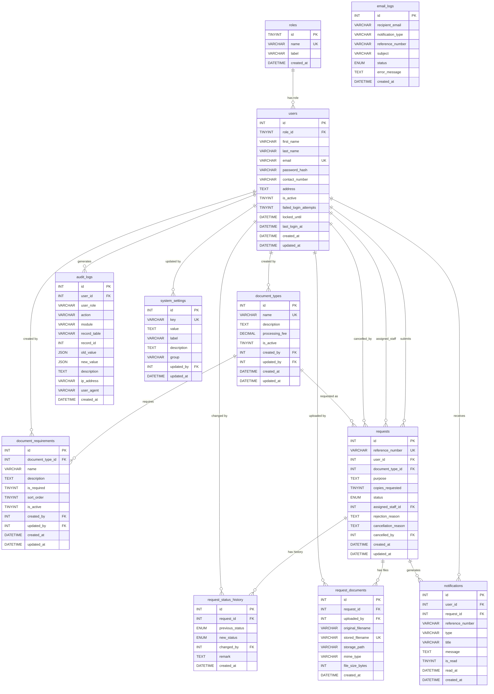

# Database Design Specification

## eMunicipal — Online Municipal Document Request and Management System
### Municipal Government Office of Lingayen, Pangasinan

---

> **Phase 2 — Database Design Only.**
> This document defines the complete MySQL database schema for eMunicipal.
> No PHP code, migrations, seeds, API endpoints, or frontend code is described here.
> All design decisions are derived exclusively from `requirements.md` and `design.md`.

---

## Table of Contents

1. [Database Overview](#1-database-overview)
2. [Design Principles](#2-design-principles)
3. [Entity List](#3-entity-list)
4. [Table Specifications](#4-table-specifications)
5. [User and Role Model](#5-user-and-role-model)
6. [Request Model](#6-request-model)
7. [Document Type Model](#7-document-type-model)
8. [File Model](#8-file-model)
9. [Notification Model](#9-notification-model)
10. [Audit Log Model](#10-audit-log-model)
11. [System Settings Model](#11-system-settings-model)
12. [Relationships](#12-relationships)
13. [ERD](#13-erd)
14. [Indexing Strategy](#14-indexing-strategy)
15. [Constraints](#15-constraints)
16. [Transaction Requirements](#16-transaction-requirements)
17. [Seed Data](#17-seed-data)
18. [Security Considerations](#18-security-considerations)
19. [Data Retention](#19-data-retention)
20. [Requirement Traceability](#20-requirement-traceability)

---

## 1. Database Overview

**Database engine:** MySQL 5.7+ (InnoDB storage engine required for all tables)

**Character set:** `utf8mb4` — supports full Unicode including emoji and multi-language characters appropriate for a government system serving the Filipino-speaking public.

**Collation:** `utf8mb4_unicode_ci` — case-insensitive, accent-insensitive comparison appropriate for name and text search.

**Total tables:** 11

| Table                    | Domain              |
|--------------------------|---------------------|
| `roles`                  | User / Auth         |
| `users`                  | User / Auth         |
| `document_types`         | Document Management |
| `document_requirements`  | Document Management |
| `requests`               | Request Workflow    |
| `request_documents`      | File Management     |
| `request_status_history` | Request Workflow    |
| `notifications`          | Notification System |
| `email_logs`             | Email / Audit       |
| `audit_logs`             | Audit / Security    |
| `system_settings`        | Configuration       |

All tables use `InnoDB` per Requirement 17.4.

---

## 2. Design Principles

1. **Third Normal Form (3NF):** All non-key columns depend solely on the primary key. No transitive dependencies. Example: document type name is stored once in `document_types`, never repeated in `requests`.

2. **Surrogate integer primary keys:** Every table uses `INT UNSIGNED AUTO_INCREMENT` as its primary key (per Req 17.6). Natural keys (e.g., email, reference number) are enforced as UNIQUE indexes, not primary keys.

3. **No soft-deletion via NULL foreign keys:** Inactive records use an `is_active` / status flag rather than nullified foreign keys. Historical references are always preserved.

4. **No binary data in MySQL:** Uploaded files are stored on the filesystem; only metadata (filename, MIME type, size, path) is stored in the database (per Req 18, design.md Section 8).

5. **No hardcoded credentials:** Mailtrap SMTP credentials are never stored in the database. The `system_settings` table stores only non-secret configuration. Credentials are managed via environment variables exclusively.

6. **Append-only audit logs:** The `audit_logs` table is insert-only from the application. No UPDATE or DELETE is ever issued against it through any application path (Req 13.3).

7. **Explicit timestamps:** Every table has `created_at DATETIME NOT NULL DEFAULT CURRENT_TIMESTAMP` and `updated_at DATETIME NOT NULL DEFAULT CURRENT_TIMESTAMP ON UPDATE CURRENT_TIMESTAMP` where records are mutable. Immutable/append-only tables (audit_logs, request_status_history, email_logs, notifications) have only `created_at`.

8. **Foreign key constraints on all relationships:** InnoDB foreign keys are defined for all inter-table references to enforce referential integrity at the database level (Req 17.2).

9. **Status as ENUM:** Request status and role are implemented using ENUM columns within their respective lookup tables (roles) or as ENUM on the requests table. See Section 6 for the rationale.

---

## 3. Entity List

| #  | Entity                    | Table                    | Purpose                                                                 |
|----|---------------------------|--------------------------|-------------------------------------------------------------------------|
| 1  | Role                      | `roles`                  | Defines the three system roles: Resident, Staff, Administrator          |
| 2  | User                      | `users`                  | All user accounts across all roles                                      |
| 3  | Document Type             | `document_types`         | Configurable municipal document categories managed by Administrator     |
| 4  | Document Requirement      | `document_requirements`  | Per-document-type supporting documents/requirements                     |
| 5  | Request                   | `requests`               | Central entity for a resident's document request                        |
| 6  | Request Document          | `request_documents`      | Metadata for uploaded supporting files attached to a request            |
| 7  | Request Status History    | `request_status_history` | Immutable log of every status change for every request                  |
| 8  | Notification              | `notifications`          | In-system notification records for residents                            |
| 9  | Email Log                 | `email_logs`             | Record of every outbound email attempt (success or failure)             |
| 10 | Audit Log                 | `audit_logs`             | Tamper-evident log of all significant system actions                    |
| 11 | System Setting            | `system_settings`        | Key-value store for administrator-configurable system parameters        |

**Entities considered and excluded:**

- **Separate `statuses` lookup table:** Evaluated and rejected. The status workflow is a fixed, well-defined set (8 values) that does not change without application code changes. An ENUM in the relevant columns is cleaner and enforced at the database level. See Section 6.1.
- **Sessions table:** PHP native sessions are used (server filesystem). No database session storage is required by the approved architecture.
- **Password reset tokens table:** Not included. Forgot password / password reset is not in the approved requirements.
- **File contents (BLOB) table:** Explicitly excluded per Req 18 and design.md Section 8. Files are stored on the filesystem.

---

## 4. Table Specifications

### 4.1 `roles`

**Purpose:** Stores the three user roles. Provides a stable foreign key target for the `users` table and allows role labels to be retrieved without hardcoding strings throughout PHP code.

**Why it exists:** Requirement 3.1 mandates exactly three roles stored in a `roles` table. A dedicated table allows role metadata (label, description) to be joined cleanly and provides a foreign key enforcement point.

| Column        | Type                              | Null     | Default | Key     | Description                                   |
|---------------|-----------------------------------|----------|---------|---------|-----------------------------------------------|
| `id`          | `TINYINT UNSIGNED AUTO_INCREMENT` | NOT NULL | —       | PRIMARY | Surrogate primary key                         |
| `name`        | `VARCHAR(20)`                     | NOT NULL | —       | UNIQUE  | Role identifier: `resident`, `staff`, `admin` |
| `label`       | `VARCHAR(50)`                     | NOT NULL | —       |         | Display label: `Resident`, `Staff`, `Administrator` |
| `created_at`  | `DATETIME`                        | NOT NULL | `CURRENT_TIMESTAMP` | | Record creation timestamp          |

**Constraints:**
- `UNIQUE (name)`
- `name` values are lowercase snake_case: `resident`, `staff`, `admin`

**Seed data:** Three rows inserted at initialization (see Section 17).

---

### 4.2 `users`

**Purpose:** Stores all user accounts — Residents, Staff, and Administrators — in a single table with a role foreign key.

**Why it exists:** A single users table with a role discriminator is the correct 3NF approach. Separate tables per role would duplicate shared columns (email, password, name) and complicate authentication logic.

| Column           | Type                              | Null     | Default             | Key      | Description                                                   |
|------------------|-----------------------------------|----------|---------------------|----------|---------------------------------------------------------------|
| `id`             | `INT UNSIGNED AUTO_INCREMENT`     | NOT NULL | —                   | PRIMARY  | Surrogate primary key                                         |
| `role_id`        | `TINYINT UNSIGNED`                | NOT NULL | —                   | FK, INDEX| Foreign key → `roles.id`                                     |
| `first_name`     | `VARCHAR(100)`                    | NOT NULL | —                   |          | User's first name                                             |
| `last_name`      | `VARCHAR(100)`                    | NOT NULL | —                   |          | User's last name                                              |
| `email`          | `VARCHAR(255)`                    | NOT NULL | —                   | UNIQUE   | Login email; unique across all roles (Req 1.3)               |
| `password_hash`  | `VARCHAR(255)`                    | NOT NULL | —                   |          | bcrypt hash via `password_hash()` (Req 1.4, 14.1)            |
| `contact_number` | `VARCHAR(20)`                     | NULL     | NULL                |          | Philippine mobile or landline (Req 1.9); NULL for system-created admin before first edit |
| `address`        | `TEXT`                            | NULL     | NULL                |          | Home address; required for Residents (Req 1.2); NULL for Staff/Admin |
| `is_active`      | `TINYINT(1)`                      | NOT NULL | `1`                 | INDEX    | 1 = active, 0 = deactivated (Req 11.4)                      |
| `failed_login_attempts` | `TINYINT UNSIGNED`         | NOT NULL | `0`                 |          | Count of consecutive failed logins (Req 14.12)               |
| `locked_until`   | `DATETIME`                        | NULL     | NULL                |          | Account locked until this timestamp; NULL = not locked (Req 14.12) |
| `last_login_at`  | `DATETIME`                        | NULL     | NULL                |          | Timestamp of most recent successful login (Req 2.6)          |
| `created_at`     | `DATETIME`                        | NOT NULL | `CURRENT_TIMESTAMP` |          | Account creation timestamp                                    |
| `updated_at`     | `DATETIME`                        | NOT NULL | `CURRENT_TIMESTAMP ON UPDATE CURRENT_TIMESTAMP` | | Last profile update |

**Constraints:**
- `UNIQUE (email)`
- `FK: role_id → roles(id) ON DELETE RESTRICT ON UPDATE CASCADE`
- `is_active` CHECK: `is_active IN (0, 1)` (enforced as TINYINT(1))

**Indexes:**
- `PRIMARY KEY (id)`
- `UNIQUE INDEX idx_users_email (email)` — Req 17.3
- `INDEX idx_users_role_id (role_id)` — joins on role
- `INDEX idx_users_is_active (is_active)` — filtering active/inactive users

**Notes:**
- `password_hash` stores the output of PHP `password_hash($password, PASSWORD_DEFAULT)`. Field length 255 accommodates current and future bcrypt/argon2 hash formats.
- `contact_number` and `address` are nullable at the database level to allow Administrator-seeded accounts to exist before a first login profile edit. Application validation enforces these fields for Resident registration (Req 1.2).
- `failed_login_attempts` and `locked_until` together implement the account lockout policy (Req 14.12: 5 attempts, 15-minute lockout).

---

### 4.3 `document_types`

**Purpose:** Stores all municipal document categories. Fully database-driven so Administrators can add, edit, activate, and deactivate types without code changes (Req 5.1).

| Column              | Type                          | Null     | Default             | Key     | Description                                             |
|---------------------|-------------------------------|----------|---------------------|---------|---------------------------------------------------------|
| `id`                | `INT UNSIGNED AUTO_INCREMENT` | NOT NULL | —                   | PRIMARY | Surrogate primary key                                   |
| `name`              | `VARCHAR(150)`                | NOT NULL | —                   | UNIQUE  | Document type name, e.g., "Barangay Clearance"          |
| `description`       | `TEXT`                        | NOT NULL | —                   |         | Full description shown to residents                     |
| `processing_fee`    | `DECIMAL(10,2)`               | NOT NULL | `0.00`              |         | Standard fee in PHP pesos (Req 5.3, data type Req 17.6) |
| `is_active`         | `TINYINT(1)`                  | NOT NULL | `1`                 | INDEX   | 1 = active (visible to residents), 0 = inactive         |
| `created_by`        | `INT UNSIGNED`                | NOT NULL | —                   | FK      | FK → `users.id` — Administrator who created this type   |
| `updated_by`        | `INT UNSIGNED`                | NULL     | NULL                | FK      | FK → `users.id` — Administrator who last updated        |
| `created_at`        | `DATETIME`                    | NOT NULL | `CURRENT_TIMESTAMP` |         | Creation timestamp                                      |
| `updated_at`        | `DATETIME`                    | NOT NULL | `CURRENT_TIMESTAMP ON UPDATE CURRENT_TIMESTAMP` | | Last update timestamp |

**Constraints:**
- `UNIQUE (name)`
- `FK: created_by → users(id) ON DELETE RESTRICT ON UPDATE CASCADE`
- `FK: updated_by → users(id) ON DELETE SET NULL ON UPDATE CASCADE`
- `processing_fee >= 0` (CHECK constraint)

**Indexes:**
- `PRIMARY KEY (id)`
- `UNIQUE INDEX idx_document_types_name (name)`
- `INDEX idx_document_types_is_active (is_active)` — filtering active types for resident form

---

### 4.4 `document_requirements`

**Purpose:** Stores per-document-type supporting document requirements. One document type can have many requirements. Each requirement can be independently activated or deactivated (Req 5.6, 5.7).

| Column              | Type                          | Null     | Default             | Key     | Description                                               |
|---------------------|-------------------------------|----------|---------------------|---------|-----------------------------------------------------------|
| `id`                | `INT UNSIGNED AUTO_INCREMENT` | NOT NULL | —                   | PRIMARY | Surrogate primary key                                     |
| `document_type_id`  | `INT UNSIGNED`                | NOT NULL | —                   | FK, INDEX| FK → `document_types.id`                               |
| `name`              | `VARCHAR(200)`                | NOT NULL | —                   |         | Requirement name, e.g., "Valid Government-Issued ID"      |
| `description`       | `TEXT`                        | NULL     | NULL                |         | Additional description/instructions for this requirement  |
| `is_required`       | `TINYINT(1)`                  | NOT NULL | `1`                 |         | 1 = mandatory, 0 = optional                               |
| `sort_order`        | `TINYINT UNSIGNED`            | NOT NULL | `0`                 |         | Display ordering within the document type requirement list|
| `is_active`         | `TINYINT(1)`                  | NOT NULL | `1`                 | INDEX   | 1 = active (shown to residents), 0 = inactive (hidden)    |
| `created_by`        | `INT UNSIGNED`                | NOT NULL | —                   | FK      | FK → `users.id` — Administrator who created this         |
| `updated_by`        | `INT UNSIGNED`                | NULL     | NULL                | FK      | FK → `users.id` — Administrator who last updated          |
| `created_at`        | `DATETIME`                    | NOT NULL | `CURRENT_TIMESTAMP` |         | Creation timestamp                                        |
| `updated_at`        | `DATETIME`                    | NOT NULL | `CURRENT_TIMESTAMP ON UPDATE CURRENT_TIMESTAMP` | | Last update timestamp |

**Constraints:**
- `FK: document_type_id → document_types(id) ON DELETE RESTRICT ON UPDATE CASCADE`
- `FK: created_by → users(id) ON DELETE RESTRICT ON UPDATE CASCADE`
- `FK: updated_by → users(id) ON DELETE SET NULL ON UPDATE CASCADE`

**Indexes:**
- `PRIMARY KEY (id)`
- `INDEX idx_doc_req_document_type_id (document_type_id)` — join from document type to its requirements
- `INDEX idx_doc_req_is_active (is_active)` — filter active requirements

---

### 4.5 `requests`

**Purpose:** The central entity. Each row represents one document request submitted by a resident. Stores current status as a denormalized ENUM for query performance; the full transition history is in `request_status_history`.

| Column              | Type                          | Null     | Default             | Key      | Description                                                       |
|---------------------|-------------------------------|----------|---------------------|----------|-------------------------------------------------------------------|
| `id`                | `INT UNSIGNED AUTO_INCREMENT` | NOT NULL | —                   | PRIMARY  | Surrogate primary key                                             |
| `reference_number`  | `VARCHAR(20)`                 | NOT NULL | —                   | UNIQUE   | Format: EMU-YYYY-NNNNNN (Req 21.1); generated by application     |
| `user_id`           | `INT UNSIGNED`                | NOT NULL | —                   | FK, INDEX| FK → `users.id` — the Resident who submitted                    |
| `document_type_id`  | `INT UNSIGNED`                | NOT NULL | —                   | FK, INDEX| FK → `document_types.id`                                        |
| `purpose`           | `TEXT`                        | NOT NULL | —                   |          | Resident's stated purpose for the request                         |
| `copies_requested`  | `TINYINT UNSIGNED`            | NOT NULL | `1`                 |          | Number of copies; must be ≥ 1 (Req 6.14)                        |
| `status`            | `ENUM('pending','under_verification','additional_info_required','approved','rejected','ready_for_claiming','completed','cancelled')` | NOT NULL | `'pending'` | INDEX | Current status (denormalized for query performance) |
| `assigned_staff_id` | `INT UNSIGNED`                | NULL     | NULL                | FK       | FK → `users.id` — Staff member currently handling; NULL if unassigned |
| `rejection_reason`  | `TEXT`                        | NULL     | NULL                |          | Required when status = rejected (Req 7.3)                        |
| `cancellation_reason` | `TEXT`                      | NULL     | NULL                |          | Optional when status = cancelled (Req 7.1 table)                 |
| `cancelled_by`      | `INT UNSIGNED`                | NULL     | NULL                | FK       | FK → `users.id` — who cancelled; NULL if not cancelled           |
| `created_at`        | `DATETIME`                    | NOT NULL | `CURRENT_TIMESTAMP` |          | Submission timestamp (same as initial PENDING history entry)      |
| `updated_at`        | `DATETIME`                    | NOT NULL | `CURRENT_TIMESTAMP ON UPDATE CURRENT_TIMESTAMP` | | Timestamp of last status change or update |

**Constraints:**
- `UNIQUE (reference_number)`
- `FK: user_id → users(id) ON DELETE RESTRICT ON UPDATE CASCADE`
- `FK: document_type_id → document_types(id) ON DELETE RESTRICT ON UPDATE CASCADE`
- `FK: assigned_staff_id → users(id) ON DELETE SET NULL ON UPDATE CASCADE`
- `FK: cancelled_by → users(id) ON DELETE SET NULL ON UPDATE CASCADE`
- `copies_requested >= 1` (CHECK constraint)

**Indexes:**
- `PRIMARY KEY (id)`
- `UNIQUE INDEX idx_requests_reference_number (reference_number)` — Req 17.3
- `INDEX idx_requests_user_id (user_id)` — Req 17.3
- `INDEX idx_requests_document_type_id (document_type_id)` — Req 17.3
- `INDEX idx_requests_status (status)` — filtering by status in staff/admin list views
- `INDEX idx_requests_created_at (created_at)` — date range filtering and reports

**Status ENUM rationale:** The 8 status values are a fixed, application-defined workflow. They will not be added or removed without corresponding application code changes. An ENUM enforces valid values at the database level, is more performant than a JOIN to a lookup table, and is self-documenting. A separate `statuses` table would add a join with no practical benefit.

---

### 4.6 `request_status_history`

**Purpose:** Append-only log of every status transition for every request. Allows reconstruction of a request's complete lifecycle. Never updated or deleted (Req 13, Req 8.2).

| Column           | Type                          | Null     | Default             | Key      | Description                                                    |
|------------------|-------------------------------|----------|---------------------|----------|----------------------------------------------------------------|
| `id`             | `INT UNSIGNED AUTO_INCREMENT` | NOT NULL | —                   | PRIMARY  | Surrogate primary key                                          |
| `request_id`     | `INT UNSIGNED`                | NOT NULL | —                   | FK, INDEX| FK → `requests.id`                                           |
| `previous_status`| `ENUM('pending','under_verification','additional_info_required','approved','rejected','ready_for_claiming','completed','cancelled')` | NULL | NULL | | Status before this change; NULL for initial PENDING entry |
| `new_status`     | `ENUM('pending','under_verification','additional_info_required','approved','rejected','ready_for_claiming','completed','cancelled')` | NOT NULL | — | | Status after this change |
| `changed_by`     | `INT UNSIGNED`                | NULL     | NULL                | FK, INDEX| FK → `users.id` — actor; NULL for system-generated (initial PENDING) |
| `remark`         | `TEXT`                        | NULL     | NULL                |          | Staff remark for additional info required; rejection reason; cancellation reason |
| `created_at`     | `DATETIME`                    | NOT NULL | `CURRENT_TIMESTAMP` | INDEX    | Timestamp of this status change                                |

**Constraints:**
- `FK: request_id → requests(id) ON DELETE RESTRICT ON UPDATE CASCADE`
- `FK: changed_by → users(id) ON DELETE SET NULL ON UPDATE CASCADE`
- No UPDATE or DELETE issued by application (append-only)

**Indexes:**
- `PRIMARY KEY (id)`
- `INDEX idx_rsh_request_id (request_id)` — Req 17.3; retrieve all history for a request
- `INDEX idx_rsh_changed_by (changed_by)` — audit queries by user
- `INDEX idx_rsh_created_at (created_at)` — chronological ordering

**Note:** The `remark` column stores context-specific text: for ADDITIONAL_INFO_REQUIRED it is the staff remark; for REJECTED it is the rejection reason; for CANCELLED it is the optional cancellation reason. This avoids separate nullable columns for each status type. The application determines the meaning from `new_status`.

---

### 4.7 `request_documents`

**Purpose:** Stores metadata for every uploaded supporting file. Files themselves are stored on the filesystem outside the web root (Req 18.5). This table stores enough metadata to serve, display, and audit files.

| Column              | Type                          | Null     | Default             | Key      | Description                                                         |
|---------------------|-------------------------------|----------|---------------------|----------|---------------------------------------------------------------------|
| `id`                | `INT UNSIGNED AUTO_INCREMENT` | NOT NULL | —                   | PRIMARY  | Surrogate primary key                                               |
| `request_id`        | `INT UNSIGNED`                | NOT NULL | —                   | FK, INDEX| FK → `requests.id`                                                |
| `uploaded_by`       | `INT UNSIGNED`                | NOT NULL | —                   | FK, INDEX| FK → `users.id` — uploader (Resident or Staff adding additional docs)|
| `original_filename` | `VARCHAR(255)`                | NOT NULL | —                   |          | Original client-provided filename (for display only; Req 18.7)     |
| `stored_filename`   | `VARCHAR(255)`                | NOT NULL | —                   | UNIQUE   | System-generated UUID filename (Req 18.4); unique to prevent collisions |
| `storage_path`      | `VARCHAR(500)`                | NOT NULL | —                   |          | Relative path from storage root to the file (never web-accessible) |
| `mime_type`         | `VARCHAR(100)`                | NOT NULL | —                   |          | MIME type validated server-side: application/pdf, image/jpeg, image/png |
| `file_size_bytes`   | `INT UNSIGNED`                | NOT NULL | —                   |          | File size in bytes; max 5MB = 5,242,880 bytes (Req 18.3)           |
| `created_at`        | `DATETIME`                    | NOT NULL | `CURRENT_TIMESTAMP` |          | Upload timestamp                                                    |

**Constraints:**
- `UNIQUE (stored_filename)` — prevents filename collisions in storage
- `FK: request_id → requests(id) ON DELETE RESTRICT ON UPDATE CASCADE`
- `FK: uploaded_by → users(id) ON DELETE RESTRICT ON UPDATE CASCADE`
- `file_size_bytes > 0` (CHECK constraint)
- `file_size_bytes <= 5242880` (CHECK constraint — 5MB maximum per Req 18.3)

**Indexes:**
- `PRIMARY KEY (id)`
- `UNIQUE INDEX idx_req_docs_stored_filename (stored_filename)`
- `INDEX idx_req_docs_request_id (request_id)` — retrieve all files for a request
- `INDEX idx_req_docs_uploaded_by (uploaded_by)` — audit queries

---

### 4.8 `notifications`

**Purpose:** Stores in-system notification records for Residents. Created whenever a relevant status change event occurs (Req 16.1). Append-only in practice but read-status is updatable.

| Column            | Type                          | Null     | Default             | Key      | Description                                                     |
|-------------------|-------------------------------|----------|---------------------|----------|-----------------------------------------------------------------|
| `id`              | `INT UNSIGNED AUTO_INCREMENT` | NOT NULL | —                   | PRIMARY  | Surrogate primary key                                           |
| `user_id`         | `INT UNSIGNED`                | NOT NULL | —                   | FK, INDEX| FK → `users.id` — Resident recipient                          |
| `request_id`      | `INT UNSIGNED`                | NULL     | NULL                | FK, INDEX| FK → `requests.id`; NULL only for system-level notifications   |
| `reference_number`| `VARCHAR(20)`                 | NULL     | NULL                |          | Denormalized reference number for display without JOIN (Req 16.5)|
| `type`            | `VARCHAR(50)`                 | NOT NULL | —                   | INDEX    | Event type: `request_submitted`, `under_verification`, `additional_info_required`, `approved`, `rejected`, `ready_for_claiming`, `completed`, `cancelled` |
| `title`           | `VARCHAR(255)`                | NOT NULL | —                   |          | Short notification title shown in bell dropdown                 |
| `message`         | `TEXT`                        | NOT NULL | —                   |          | Full notification message body (Req 16.5)                      |
| `is_read`         | `TINYINT(1)`                  | NOT NULL | `0`                 | INDEX    | 0 = unread, 1 = read (Req 16.3)                               |
| `read_at`         | `DATETIME`                    | NULL     | NULL                |          | Timestamp when marked as read; NULL if unread                  |
| `created_at`      | `DATETIME`                    | NOT NULL | `CURRENT_TIMESTAMP` | INDEX    | Notification creation timestamp                                 |

**Constraints:**
- `FK: user_id → users(id) ON DELETE CASCADE ON UPDATE CASCADE` — delete notifications if user is deleted (though user deletion is prevented by Req 11.9; this handles edge cases)
- `FK: request_id → requests(id) ON DELETE SET NULL ON UPDATE CASCADE` — retain notification if request is somehow removed

**Indexes:**
- `PRIMARY KEY (id)`
- `INDEX idx_notifications_user_id (user_id)` — retrieve all notifications for a user
- `INDEX idx_notifications_user_unread (user_id, is_read)` — unread count query (Req 16.2)
- `INDEX idx_notifications_request_id (request_id)` — link back to request
- `INDEX idx_notifications_created_at (created_at)` — chronological ordering

---

### 4.9 `email_logs`

**Purpose:** Records every outbound email attempt — success or failure — for audit and debugging (Req 10.3, 10.4). Append-only.

| Column             | Type                          | Null     | Default             | Key      | Description                                                   |
|--------------------|-------------------------------|----------|---------------------|----------|---------------------------------------------------------------|
| `id`               | `INT UNSIGNED AUTO_INCREMENT` | NOT NULL | —                   | PRIMARY  | Surrogate primary key                                         |
| `recipient_email`  | `VARCHAR(255)`                | NOT NULL | —                   | INDEX    | Email address of the recipient                                |
| `notification_type`| `VARCHAR(50)`                 | NOT NULL | —                   |          | Event type matching notifications.type values                 |
| `reference_number` | `VARCHAR(20)`                 | NULL     | NULL                |          | Request reference number where applicable; NULL for registration email |
| `subject`          | `VARCHAR(255)`                | NOT NULL | —                   |          | Email subject line sent                                       |
| `status`           | `ENUM('sent','failed')`       | NOT NULL | —                   | INDEX    | Outcome of the send attempt                                   |
| `error_message`    | `TEXT`                        | NULL     | NULL                |          | Error detail if status = failed; NULL if sent                 |
| `created_at`       | `DATETIME`                    | NOT NULL | `CURRENT_TIMESTAMP` | INDEX    | Timestamp of the send attempt                                 |

**Constraints:**
- No foreign key to `requests.reference_number` — reference number is stored as a string snapshot to preserve the log even if the request record is somehow affected. This is intentional denormalization for audit integrity.

**Indexes:**
- `PRIMARY KEY (id)`
- `INDEX idx_email_logs_recipient (recipient_email)`
- `INDEX idx_email_logs_status (status)` — query failed emails
- `INDEX idx_email_logs_created_at (created_at)` — date range queries

---

### 4.10 `audit_logs`

**Purpose:** Tamper-evident, append-only record of all significant system actions (Req 13). Every user action and key system event produces a row here. Never updated or deleted through the application.

| Column          | Type                          | Null     | Default             | Key      | Description                                                        |
|-----------------|-------------------------------|----------|---------------------|----------|--------------------------------------------------------------------|
| `id`            | `INT UNSIGNED AUTO_INCREMENT` | NOT NULL | —                   | PRIMARY  | Surrogate primary key                                              |
| `user_id`       | `INT UNSIGNED`                | NULL     | NULL                | FK, INDEX| FK → `users.id` — acting user; NULL for system-generated events   |
| `user_role`     | `VARCHAR(20)`                 | NULL     | NULL                |          | Snapshot of role at time of action (denormalized — role may change)|
| `action`        | `VARCHAR(100)`                | NOT NULL | —                   | INDEX    | Action identifier, e.g., `user_login`, `request_submitted`, `status_changed` |
| `module`        | `VARCHAR(50)`                 | NOT NULL | —                   |          | System module, e.g., `auth`, `requests`, `users`, `documents`     |
| `record_table`  | `VARCHAR(64)`                 | NULL     | NULL                |          | Name of the affected table, e.g., `requests`, `users`             |
| `record_id`     | `INT UNSIGNED`                | NULL     | NULL                |          | ID of the affected record                                          |
| `old_value`     | `JSON`                        | NULL     | NULL                |          | Previous state (JSON-serialized) for change tracking (Req 13.2)   |
| `new_value`     | `JSON`                        | NULL     | NULL                |          | New state (JSON-serialized) for change tracking                    |
| `description`   | `TEXT`                        | NULL     | NULL                |          | Human-readable description of the action                           |
| `ip_address`    | `VARCHAR(45)`                 | NULL     | NULL                |          | IPv4 or IPv6 address (max 45 chars for IPv6; Req 13.2)            |
| `user_agent`    | `VARCHAR(500)`                | NULL     | NULL                |          | HTTP User-Agent header for device/browser context                  |
| `created_at`    | `DATETIME`                    | NOT NULL | `CURRENT_TIMESTAMP` | INDEX    | Timestamp of the event                                             |

**Constraints:**
- `FK: user_id → users(id) ON DELETE SET NULL ON UPDATE CASCADE` — retain audit entry if user is deactivated; SET NULL preserves the log
- No UPDATE or DELETE issued by application

**Indexes:**
- `PRIMARY KEY (id)`
- `INDEX idx_audit_logs_user_id (user_id)` — Req 17.3
- `INDEX idx_audit_logs_created_at (created_at)` — Req 17.3; date range filtering
- `INDEX idx_audit_logs_action (action)` — filter by action type
- `INDEX idx_audit_logs_record (record_table, record_id)` — find all log entries for a specific record

**Audited events (per Req 13.1):**

| Event                        | `action` value               | `module`   |
|------------------------------|------------------------------|------------|
| User login                   | `user_login`                 | `auth`     |
| User logout                  | `user_logout`                | `auth`     |
| Failed login attempt         | `login_failed`               | `auth`     |
| Account lockout              | `account_locked`             | `auth`     |
| Account created              | `account_created`            | `users`    |
| Account deactivated          | `account_deactivated`        | `users`    |
| Account reactivated          | `account_reactivated`        | `users`    |
| Password changed             | `password_changed`           | `users`    |
| Document type created        | `document_type_created`      | `documents`|
| Document type modified       | `document_type_modified`     | `documents`|
| Requirement created          | `requirement_created`        | `documents`|
| Requirement modified         | `requirement_modified`       | `documents`|
| Request submitted            | `request_submitted`          | `requests` |
| Request status changed       | `request_status_changed`     | `requests` |
| File uploaded                | `file_uploaded`              | `files`    |
| File downloaded              | `file_downloaded`            | `files`    |
| Report generated             | `report_generated`           | `reports`  |
| System setting changed       | `setting_changed`            | `settings` |

---

### 4.11 `system_settings`

**Purpose:** Key-value store for administrator-configurable system parameters (Req 20). Allows operational values to be changed through the admin UI without code changes.

| Column        | Type                          | Null     | Default             | Key     | Description                                        |
|---------------|-------------------------------|----------|---------------------|---------|----------------------------------------------------|
| `id`          | `INT UNSIGNED AUTO_INCREMENT` | NOT NULL | —                   | PRIMARY | Surrogate primary key                              |
| `key`         | `VARCHAR(100)`                | NOT NULL | —                   | UNIQUE  | Setting identifier, e.g., `office_name`            |
| `value`       | `TEXT`                        | NOT NULL | —                   |         | Setting value as string; application parses type   |
| `label`       | `VARCHAR(200)`                | NOT NULL | —                   |         | Human-readable label shown in admin settings UI    |
| `description` | `TEXT`                        | NULL     | NULL                |         | Optional description of the setting's effect       |
| `group`       | `VARCHAR(50)`                 | NOT NULL | —                   | INDEX   | Grouping: `municipal_info`, `contact`, `system`, `email_status` |
| `updated_by`  | `INT UNSIGNED`                | NULL     | NULL                | FK      | FK → `users.id` — last Administrator to update    |
| `updated_at`  | `DATETIME`                    | NOT NULL | `CURRENT_TIMESTAMP ON UPDATE CURRENT_TIMESTAMP` | | Last update timestamp |

**Constraints:**
- `UNIQUE (key)`
- `FK: updated_by → users(id) ON DELETE SET NULL ON UPDATE CASCADE`

**Indexes:**
- `PRIMARY KEY (id)`
- `UNIQUE INDEX idx_system_settings_key (key)` — lookup by key
- `INDEX idx_system_settings_group (group)` — load settings by group

**Required keys (seeded at initialization, Req 20.2):**

| Key                    | Group            | Default Value           | Description                              |
|------------------------|------------------|-------------------------|------------------------------------------|
| `office_name`          | `municipal_info` | Municipal Government of Lingayen | Office display name             |
| `office_address`       | `municipal_info` | Lingayen, Pangasinan    | Office address                           |
| `office_contact_number`| `contact`        | (075) XXX-XXXX          | Office phone number                      |
| `office_email`         | `contact`        | municipal@lingayen.gov.ph | Office email                           |
| `max_upload_size_mb`   | `system`         | 5                       | Maximum file upload size in MB           |
| `session_timeout_minutes` | `system`      | 30                      | Inactivity session timeout in minutes    |
| `records_per_page`     | `system`         | 20                      | Default pagination page size             |
| `email_service_status` | `email_status`   | configured_via_env      | Informational only — no credentials stored |

**Critical:** No Mailtrap credentials (`MAIL_USERNAME`, `MAIL_PASSWORD`, `MAIL_HOST`, `MAIL_PORT`) are stored in this table. Those values live exclusively in the server `.env` file (Req 10.2, 10.7, 14.8).

---

## 5. User and Role Model

### 5.1 Role Design Decision

**Decision: Dedicated `roles` table (not ENUM on `users`)**

**Rationale:**
- Requirement 3.1 explicitly states roles are "each stored in the roles table."
- A dedicated table allows clean JOIN for displaying the role label in admin UI without hardcoding strings.
- Foreign key from `users.role_id` → `roles.id` enforces role validity at the database level.
- Extensible: a future fourth role could be added with a single INSERT, not an ALTER TABLE.

### 5.2 Password Storage

- Stored in `users.password_hash` as the output of PHP `password_hash($password, PASSWORD_DEFAULT)`.
- `PASSWORD_DEFAULT` currently resolves to `PASSWORD_BCRYPT` (cost factor 10).
- Field length `VARCHAR(255)` future-proofs for longer hashes (Argon2id is 95 chars; bcrypt is 60).
- Plain-text passwords are **never** stored anywhere in the database.

### 5.3 Account Lockout Implementation

The `users` table supports the lockout policy (Req 14.12) with two columns:
- `failed_login_attempts`: incremented on each failed login, reset to 0 on successful login.
- `locked_until`: set to `NOW() + 15 minutes` when `failed_login_attempts` reaches 5. NULL when not locked.

Application logic checks `locked_until > NOW()` before processing a login attempt.

### 5.4 Administrator Initialization

The seeded Administrator account (Req 11.10) is inserted directly into the `users` table during database initialization with:
- `role_id` pointing to the `admin` role
- A securely hashed temporary password (provided as a configuration parameter at deploy time — never hardcoded in migration files or seed scripts)
- `is_active = 1`

The application prevents this account from being deactivated via the UI (enforced at the application layer by checking if the target user is the last active Administrator).

---

## 6. Request Model

### 6.1 Status Representation

**Decision: ENUM on `requests.status` and `request_status_history.new_status`/`previous_status`**

**Rationale:**
- The 8 statuses are a fixed, well-defined workflow that does not change independently of application code.
- ENUM provides database-level enforcement of valid values with zero JOIN cost.
- A separate `request_statuses` lookup table would add a JOIN on every request query with no added flexibility.
- Status labels for UI display are maintained in application code (design.md Section 2.5 color mapping).

**ENUM values (lowercase, snake_case):**
```
'pending', 'under_verification', 'additional_info_required',
'approved', 'rejected', 'ready_for_claiming', 'completed', 'cancelled'
```

### 6.2 Reference Number Generation

The reference number format `EMU-YYYY-NNNNNN` (Req 21.1) is generated by the application inside a database transaction:

1. Within a transaction with `SELECT ... FOR UPDATE` on the `requests` table.
2. Query `MAX(reference_number)` for the current year using `LIKE 'EMU-YYYY-%'`.
3. Increment the sequence or start at 1 for a new year.
4. Zero-pad to 6 digits.
5. INSERT the new request row with the generated reference number.
6. The `UNIQUE` constraint on `reference_number` acts as a final safety net against concurrent duplicates.

### 6.3 Request Lifecycle

The `requests.status` column is the authoritative current status. The `request_status_history` table records every transition. Together they satisfy:
- Req 8.2: full status history display
- Req 7.5: every status change recorded with timestamp, actor, and remarks
- Req 17.5: request creation within a transaction that also creates the initial history entry

### 6.4 Rejected/Cancelled Data

- `rejection_reason` on `requests` stores the final rejection reason (denormalized for quick display on request detail page without joining history).
- `cancellation_reason` and `cancelled_by` similarly denormalize cancellation context.
- The same information is also recorded in `request_status_history.remark` for the historical record.

---

## 7. Document Type Model

### 7.1 Database-Driven Document Types

Document types are fully managed through the `document_types` and `document_requirements` tables (Req 5.1). No document type name, description, or requirement is hardcoded in PHP source files.

### 7.2 Requirement Ordering

The `sort_order` column on `document_requirements` allows Administrators to control the display order of requirements in the checklist shown to residents. Default value 0; the UI renders requirements `ORDER BY sort_order ASC, id ASC`.

### 7.3 Deactivation Behavior

- Deactivating a `document_type` (setting `is_active = 0`) prevents new requests but does not affect existing requests (`requests.document_type_id` is preserved — RESTRICT on delete, per Req 5.4).
- Deactivating a `document_requirement` (setting `is_active = 0`) removes it from the new-request checklist but the `request_documents` records for historical requests that uploaded against it are preserved (per Req 5.8).

---

## 8. File Model

### 8.1 Filesystem-Only File Storage

Uploaded files are stored on the server filesystem in a directory outside the web server document root (Req 18.5). The `request_documents` table stores only metadata. This approach:
- Prevents direct HTTP access to uploaded files
- Allows the PHP download handler to enforce access control before serving any file (Req 18.8)
- Avoids BLOB storage performance and backup complexity

### 8.2 Stored Filename Strategy

The application generates a UUID v4 as the stored filename (Req 18.4), appending the validated MIME-derived extension:
- `application/pdf` → `.pdf`
- `image/jpeg` → `.jpg`
- `image/png` → `.png`

Example stored filename: `a3f7c291-4e2b-4d1a-9f0e-123456789abc.pdf`

The `stored_filename` UNIQUE constraint prevents any collision. The original filename is preserved in `original_filename` for display to staff and residents (shown in the UI per design.md Sections 8.4, 9.3).

### 8.3 Storage Path

The `storage_path` column stores a relative path from the application's configured upload root (set in `.env`), for example: `uploads/2026/01/a3f7c291-4e2b-4d1a-9f0e-123456789abc.pdf`. The absolute path is never stored in the database; it is constructed at runtime by prepending the upload root from environment configuration.

### 8.4 Access Control for Downloads

When a file download is requested (by Resident or Staff), the PHP download handler:
1. Queries `request_documents` by `id` to retrieve `stored_filename`, `storage_path`, `original_filename`, `mime_type`.
2. Checks that the requesting user has permission (Resident owns the request, or Staff/Admin role).
3. Streams the file with `Content-Disposition: attachment; filename="[original_filename]"`.
4. Logs the download in `audit_logs`.

The `storage_path` in the database is used solely by this handler and never exposed to the client.

---

## 9. Notification Model

### 9.1 In-System vs Email Notifications

Two separate systems handle notifications:
- **In-system notifications:** `notifications` table — for Residents, updated in real time via page load (Req 16).
- **Email notifications:** sent via Mailtrap; logged in `email_logs` table (Req 10).

These are independent: a failed email does not affect the in-system notification record, and vice versa (Req 10.4).

### 9.2 Notification Types

The `type` column uses these string constants:

| Type value                  | Triggered by                                  |
|-----------------------------|-----------------------------------------------|
| `request_submitted`         | Request creation (status → pending)           |
| `under_verification`        | Status → under_verification                   |
| `additional_info_required`  | Status → additional_info_required             |
| `approved`                  | Status → approved                             |
| `rejected`                  | Status → rejected                             |
| `ready_for_claiming`        | Status → ready_for_claiming                   |
| `completed`                 | Status → completed                            |
| `cancelled`                 | Status → cancelled                            |

### 9.3 Unread Count Query

The unread notification count displayed in the navigation bell (Req 16.2) is served by:
```sql
SELECT COUNT(*) FROM notifications
WHERE user_id = :user_id AND is_read = 0;
```
The composite index `(user_id, is_read)` makes this query efficient.

### 9.4 Read Marking

When a Resident clicks a notification (Req 16.4):
```sql
UPDATE notifications
SET is_read = 1, read_at = NOW()
WHERE id = :id AND user_id = :user_id;
```
The `user_id` check prevents one resident from marking another's notifications as read.

---

## 10. Audit Log Model

### 10.1 Append-Only Guarantee

The application never issues UPDATE or DELETE against `audit_logs`. The database account used by the application should ideally be granted only INSERT + SELECT on `audit_logs` (principle of least privilege, Section 18).

### 10.2 JSON Change Tracking

The `old_value` and `new_value` JSON columns store a snapshot of the relevant fields before and after a change. Examples:

**Account deactivation:**
```json
old_value: {"is_active": 1}
new_value:  {"is_active": 0}
```

**Document type fee change:**
```json
old_value: {"processing_fee": "50.00"}
new_value:  {"processing_fee": "75.00"}
```

**Request status change:**
```json
old_value: {"status": "pending"}
new_value:  {"status": "under_verification"}
```

### 10.3 System Events

For system-generated events (e.g., registration email sent, session expiry), `user_id` is NULL and `user_role` is NULL. The `description` column provides a human-readable explanation.

---

## 11. System Settings Model

### 11.1 Key-Value Design

Settings are stored as string key-value pairs. The application is responsible for parsing and validating the type of each value (e.g., casting `max_upload_size_mb` to integer, `session_timeout_minutes` to integer).

### 11.2 Email Configuration

The `email_service_status` setting stores only an informational string (e.g., `"configured_via_env"` or `"not_configured"`). It exists solely to display a status indicator in the admin settings UI (design.md Section 10.7). It never stores credentials.

### 11.3 Settings Validation

Per Req 20.3, the application validates each setting value before saving:

| Key                       | Expected type | Valid range/values         |
|---------------------------|---------------|----------------------------|
| `office_name`             | string        | 1–200 characters           |
| `office_address`          | string        | 1–500 characters           |
| `office_contact_number`   | string        | 1–50 characters            |
| `office_email`            | string        | valid email format         |
| `max_upload_size_mb`      | integer       | 1–20                       |
| `session_timeout_minutes` | integer       | 5–120                      |
| `records_per_page`        | integer       | 10, 20, or 50              |

---

## 12. Relationships

### 12.1 Complete Foreign Key Relationship Map

| Parent Table          | Child Table              | FK Column (child)           | Relationship | ON DELETE       | ON UPDATE  |
|-----------------------|--------------------------|-----------------------------|--------------|-----------------|------------|
| `roles`               | `users`                  | `role_id`                   | 1:N          | RESTRICT        | CASCADE    |
| `users`               | `requests`               | `user_id`                   | 1:N          | RESTRICT        | CASCADE    |
| `users`               | `requests`               | `assigned_staff_id`         | 1:N (opt.)   | SET NULL        | CASCADE    |
| `users`               | `requests`               | `cancelled_by`              | 1:N (opt.)   | SET NULL        | CASCADE    |
| `document_types`      | `requests`               | `document_type_id`          | 1:N          | RESTRICT        | CASCADE    |
| `requests`            | `request_status_history` | `request_id`                | 1:N          | RESTRICT        | CASCADE    |
| `users`               | `request_status_history` | `changed_by`                | 1:N (opt.)   | SET NULL        | CASCADE    |
| `requests`            | `request_documents`      | `request_id`                | 1:N          | RESTRICT        | CASCADE    |
| `users`               | `request_documents`      | `uploaded_by`               | 1:N          | RESTRICT        | CASCADE    |
| `users`               | `notifications`          | `user_id`                   | 1:N          | CASCADE         | CASCADE    |
| `requests`            | `notifications`          | `request_id`                | 1:N (opt.)   | SET NULL        | CASCADE    |
| `users`               | `audit_logs`             | `user_id`                   | 1:N (opt.)   | SET NULL        | CASCADE    |
| `users`               | `document_types`         | `created_by`                | 1:N          | RESTRICT        | CASCADE    |
| `users`               | `document_types`         | `updated_by`                | 1:N (opt.)   | SET NULL        | CASCADE    |
| `document_types`      | `document_requirements`  | `document_type_id`          | 1:N          | RESTRICT        | CASCADE    |
| `users`               | `document_requirements`  | `created_by`                | 1:N          | RESTRICT        | CASCADE    |
| `users`               | `document_requirements`  | `updated_by`                | 1:N (opt.)   | SET NULL        | CASCADE    |
| `users`               | `system_settings`        | `updated_by`                | 1:N (opt.)   | SET NULL        | CASCADE    |

### 12.2 ON DELETE Behavior Rationale

- **RESTRICT** on `user_id → requests`: Residents cannot be deleted if they have requests (Req 11.9). Deactivation is used instead.
- **RESTRICT** on `document_type_id → requests`: Document types cannot be deleted while requests reference them. Deactivation is used instead.
- **SET NULL** on `assigned_staff_id`, `cancelled_by`, `changed_by`, `uploaded_by` (where nullable): Preserves the parent record (request, history entry) if the referenced user is somehow removed, while indicating the actor is unknown.
- **CASCADE** on `user_id → notifications`: Notifications are user-specific and have no independent value without the user.
- **RESTRICT** on `uploaded_by → request_documents`: A file's uploader record must be preserved for audit integrity; uploader accounts should be deactivated, not deleted.

---

## 13. ERD

### 13.1 Text-Based ERD

```
roles
│
└──< users
        │
        ├──< requests ──────────────────────────────────┐
        │       │                                        │
        │       ├──< request_status_history              │
        │       │         └── changed_by → users         │
        │       │                                        │
        │       ├──< request_documents                   │
        │       │         └── uploaded_by → users        │
        │       │                                        │
        │       └──< notifications                       │
        │                 └── user_id → users            │
        │                                                │
        ├──< notifications                               │
        │                                                │
        └──< audit_logs                                  │
                                                         │
document_types ──────────────────────────────────────────┘
        │
        ├──< document_requirements
        │
        └──< requests (document_type_id)

system_settings
        └── updated_by → users
```

### 13.2 Mermaid ERD



---

## 14. Indexing Strategy

### 14.1 Index Inventory

| Table                    | Index Name                              | Columns                          | Type    | Purpose                                                         |
|--------------------------|-----------------------------------------|----------------------------------|---------|-----------------------------------------------------------------|
| `roles`                  | PRIMARY                                 | `id`                             | PK      | Row identification                                              |
| `roles`                  | `idx_roles_name`                        | `name`                           | UNIQUE  | Role lookup by name                                             |
| `users`                  | PRIMARY                                 | `id`                             | PK      | Row identification                                              |
| `users`                  | `idx_users_email`                       | `email`                          | UNIQUE  | Login lookup; uniqueness enforcement (Req 17.3)                 |
| `users`                  | `idx_users_role_id`                     | `role_id`                        | INDEX   | Join to roles; filter by role in admin UI                       |
| `users`                  | `idx_users_is_active`                   | `is_active`                      | INDEX   | Filter active/inactive users                                    |
| `document_types`         | PRIMARY                                 | `id`                             | PK      | Row identification                                              |
| `document_types`         | `idx_document_types_name`               | `name`                           | UNIQUE  | Uniqueness enforcement; name search                             |
| `document_types`         | `idx_document_types_is_active`          | `is_active`                      | INDEX   | Filter active document types for resident form                  |
| `document_requirements`  | PRIMARY                                 | `id`                             | PK      | Row identification                                              |
| `document_requirements`  | `idx_doc_req_document_type_id`          | `document_type_id`               | INDEX   | Load requirements for a given document type                     |
| `document_requirements`  | `idx_doc_req_is_active`                 | `is_active`                      | INDEX   | Filter active requirements                                      |
| `requests`               | PRIMARY                                 | `id`                             | PK      | Row identification                                              |
| `requests`               | `idx_requests_reference_number`         | `reference_number`               | UNIQUE  | Reference number lookup and uniqueness (Req 17.3)               |
| `requests`               | `idx_requests_user_id`                  | `user_id`                        | INDEX   | Load all requests for a resident (Req 17.3)                     |
| `requests`               | `idx_requests_document_type_id`         | `document_type_id`               | INDEX   | Filter requests by document type (Req 17.3)                     |
| `requests`               | `idx_requests_status`                   | `status`                         | INDEX   | Filter requests by status (staff/admin list views)              |
| `requests`               | `idx_requests_created_at`               | `created_at`                     | INDEX   | Date range filtering and report generation                      |
| `request_status_history` | PRIMARY                                 | `id`                             | PK      | Row identification                                              |
| `request_status_history` | `idx_rsh_request_id`                    | `request_id`                     | INDEX   | Load all history for a request (Req 17.3)                       |
| `request_status_history` | `idx_rsh_changed_by`                    | `changed_by`                     | INDEX   | Audit queries — who changed what                               |
| `request_status_history` | `idx_rsh_created_at`                    | `created_at`                     | INDEX   | Chronological ordering of history                               |
| `request_documents`      | PRIMARY                                 | `id`                             | PK      | Row identification                                              |
| `request_documents`      | `idx_req_docs_stored_filename`          | `stored_filename`                | UNIQUE  | Uniqueness enforcement; filename lookup                         |
| `request_documents`      | `idx_req_docs_request_id`               | `request_id`                     | INDEX   | Load all files for a request                                    |
| `request_documents`      | `idx_req_docs_uploaded_by`              | `uploaded_by`                    | INDEX   | Audit — files uploaded by a specific user                       |
| `notifications`          | PRIMARY                                 | `id`                             | PK      | Row identification                                              |
| `notifications`          | `idx_notifications_user_id`             | `user_id`                        | INDEX   | Load notifications for a user                                   |
| `notifications`          | `idx_notifications_user_unread`         | `(user_id, is_read)`             | INDEX   | Unread count query (Req 16.2) — composite for efficiency        |
| `notifications`          | `idx_notifications_request_id`          | `request_id`                     | INDEX   | Link notifications to request                                   |
| `notifications`          | `idx_notifications_created_at`          | `created_at`                     | INDEX   | Reverse chronological listing                                   |
| `email_logs`             | PRIMARY                                 | `id`                             | PK      | Row identification                                              |
| `email_logs`             | `idx_email_logs_recipient`              | `recipient_email`                | INDEX   | Query emails sent to a recipient                                |
| `email_logs`             | `idx_email_logs_status`                 | `status`                         | INDEX   | Query failed emails                                             |
| `email_logs`             | `idx_email_logs_created_at`             | `created_at`                     | INDEX   | Date range queries                                              |
| `audit_logs`             | PRIMARY                                 | `id`                             | PK      | Row identification                                              |
| `audit_logs`             | `idx_audit_logs_user_id`                | `user_id`                        | INDEX   | Filter by user (Req 17.3)                                       |
| `audit_logs`             | `idx_audit_logs_created_at`             | `created_at`                     | INDEX   | Date range filtering (Req 17.3)                                 |
| `audit_logs`             | `idx_audit_logs_action`                 | `action`                         | INDEX   | Filter by action type                                           |
| `audit_logs`             | `idx_audit_logs_record`                 | `(record_table, record_id)`      | INDEX   | Find all log entries for a specific record                      |
| `system_settings`        | PRIMARY                                 | `id`                             | PK      | Row identification                                              |
| `system_settings`        | `idx_system_settings_key`               | `key`                            | UNIQUE  | Key lookup for reading/writing settings                         |
| `system_settings`        | `idx_system_settings_group`             | `group`                          | INDEX   | Load all settings in a group for admin UI section               |

### 14.2 Index Justification Notes

- **Composite index `(user_id, is_read)` on `notifications`:** The most frequent notification query is "count unread for user X." A composite index serves this query without a full table scan.
- **`idx_audit_logs_record (record_table, record_id)`:** Enables efficient lookup of "all audit entries affecting request EMU-2026-000014" by combining table name and record ID.
- **`idx_requests_status`:** Status filtering is the most common operation on the staff request list view. Without this index, every page load of the staff dashboard would scan the full requests table.
- **Indexes are not created on:** `audit_logs.ip_address` (not filtered in any approved query), `email_logs.notification_type` (low cardinality, covered by status index), `notifications.read_at` (not queried independently).

---

## 15. Constraints

### 15.1 Unique Constraints

| Table                   | Column(s)           | Enforcement                              |
|-------------------------|---------------------|------------------------------------------|
| `roles`                 | `name`              | `UNIQUE INDEX`                           |
| `users`                 | `email`             | `UNIQUE INDEX` (Req 1.3)                 |
| `document_types`        | `name`              | `UNIQUE INDEX`                           |
| `requests`              | `reference_number`  | `UNIQUE INDEX` (Req 21.3, 21.4)          |
| `request_documents`     | `stored_filename`   | `UNIQUE INDEX` (Req 18.4)                |
| `system_settings`       | `key`               | `UNIQUE INDEX`                           |

### 15.2 CHECK Constraints

| Table                   | Column              | Constraint                               | Reason                          |
|-------------------------|---------------------|------------------------------------------|---------------------------------|
| `requests`              | `copies_requested`  | `copies_requested >= 1`                  | Req 6.14                        |
| `document_types`        | `processing_fee`    | `processing_fee >= 0`                    | Fee cannot be negative          |
| `request_documents`     | `file_size_bytes`   | `file_size_bytes > 0`                    | Empty files are invalid         |
| `request_documents`     | `file_size_bytes`   | `file_size_bytes <= 5242880`             | 5MB maximum (Req 18.3)          |
| `users`                 | `is_active`         | Implicit via TINYINT(1) convention       | 0 or 1 only                     |

> Note: CHECK constraints are fully supported in MySQL 8.0.16+. For MySQL 5.7, CHECK constraints are parsed but not enforced; application-level validation handles these in that environment.

### 15.3 Foreign Key Constraints Summary

All foreign keys use:
- `ON UPDATE CASCADE` — if a primary key changes (rare with surrogate PKs), all referencing rows update automatically.
- `ON DELETE RESTRICT` for critical parent records (users with requests, document types with requests) — prevents accidental deletion.
- `ON DELETE SET NULL` for optional/audit references — preserves child records when referenced parent is removed.
- `ON DELETE CASCADE` only for `notifications.user_id` — notifications are meaningless without their recipient.

### 15.4 NOT NULL Enforcement

All columns that must always have a value are declared `NOT NULL`. Nullable columns are explicitly documented with the reason for nullability (e.g., `contact_number NULL` — not yet collected for seeded admin accounts; `changed_by NULL` — system-generated initial status entries).

---

## 16. Transaction Requirements

The following operations MUST be executed within a database transaction. If any step fails, the entire transaction is rolled back (Req 20.6).

### 16.1 Request Submission

**Operations within one transaction:**
1. INSERT into `requests` (with generated reference number)
2. INSERT into `request_status_history` (initial PENDING entry, `changed_by = NULL`)
3. INSERT into `notifications` (request_submitted notification for the resident)
4. INSERT into `email_logs` (after email send attempt — committed regardless of email success/failure)

**Rollback triggers:** Any INSERT failure (constraint violation, deadlock, connection error).

**Result of rollback:** No request record exists, no history entry, no notification. User sees a descriptive error message (Req 20.6). The email attempt, if already dispatched, is an acceptable side effect (emails are idempotent in this context).

### 16.2 Status Transition

**Operations within one transaction:**
1. UPDATE `requests.status`, `requests.updated_at` (and `rejection_reason`/`cancellation_reason`/`cancelled_by` as applicable)
2. INSERT into `request_status_history`
3. INSERT into `notifications`

**Rollback triggers:** Any step failure.

**Result of rollback:** Status remains unchanged. No orphaned history entry. User sees error message.

### 16.3 Request Cancellation (by Resident or Staff)

Same as Status Transition (16.2). Additionally updates `cancelled_by` on `requests`.

### 16.4 File Upload

**Operations within one transaction:**
1. INSERT into `request_documents`
2. INSERT into `audit_logs` (file_uploaded event)

The physical file write to the filesystem happens before the transaction. If the transaction fails, the application deletes the orphaned file.

### 16.5 User Account Operations (Create/Deactivate/Reactivate)

**Operations within one transaction:**
1. INSERT or UPDATE `users`
2. INSERT into `audit_logs`

### 16.6 Document Type / Requirement Changes

**Operations within one transaction:**
1. INSERT or UPDATE `document_types` or `document_requirements`
2. INSERT into `audit_logs`

### 16.7 System Settings Change

**Operations within one transaction:**
1. UPDATE `system_settings`
2. INSERT into `audit_logs` (with `old_value` and `new_value`)

### 16.8 Reference Number Generation (Concurrency Safety)

The reference number sequence generation (Req 21.3) uses:
```sql
START TRANSACTION;
SELECT reference_number FROM requests
  WHERE reference_number LIKE 'EMU-2026-%'
  ORDER BY reference_number DESC
  LIMIT 1
  FOR UPDATE;
-- Application generates next number
INSERT INTO requests (..., reference_number, ...) VALUES (...);
COMMIT;
```
`FOR UPDATE` acquires a row-level lock preventing concurrent submissions from generating the same number. The UNIQUE constraint is the final safety net.

---

## 17. Seed Data

The following rows must be inserted during system initialization before the application becomes usable.

### 17.1 `roles` Seed Data

| id | name        | label           |
|----|-------------|-----------------|
| 1  | `resident`  | Resident        |
| 2  | `staff`     | Staff           |
| 3  | `admin`     | Administrator   |

### 17.2 `users` — Initial Administrator Account

One Administrator account is seeded at initialization (Req 11.10).

| Column           | Value                                                   |
|------------------|---------------------------------------------------------|
| `role_id`        | 3 (admin)                                               |
| `first_name`     | `System`                                                |
| `last_name`      | `Administrator`                                         |
| `email`          | Configured via deployment parameter (not hardcoded)     |
| `password_hash`  | `password_hash($ADMIN_INITIAL_PASSWORD, PASSWORD_DEFAULT)` — password provided at deploy time, never hardcoded |
| `contact_number` | NULL (to be updated on first login)                     |
| `address`        | NULL                                                    |
| `is_active`      | 1                                                       |

**Important:** The initial Administrator password is provided as a runtime configuration value (e.g., via environment variable `ADMIN_INITIAL_PASSWORD` consumed only during the seed script execution). It is never committed to version control. After first login, the Administrator should change this password via the profile page.

### 17.3 `system_settings` Seed Data

All 8 settings listed in Section 11.3 are seeded with default values. The `updated_by` column is NULL for seeded settings (no administrator action yet).

### 17.4 No Other Seed Data

- Document types and their requirements are **not** seeded. These are created by the Administrator through the admin UI (Req 5.2).
- Request statuses are not a separate table — ENUM values require no seed data.

---

## 18. Security Considerations

### 18.1 Password Storage

- `users.password_hash` stores only the output of `password_hash($password, PASSWORD_DEFAULT)`.
- `PASSWORD_DEFAULT` uses bcrypt (cost 10) in PHP 5.5–8.x, or Argon2id in future versions.
- Plain-text passwords are never inserted, selected, or logged anywhere in the database.
- Password comparison uses `password_verify()` — never string equality on hash values.

### 18.2 Credential Protection

- Mailtrap SMTP credentials (`MAIL_HOST`, `MAIL_PORT`, `MAIL_USERNAME`, `MAIL_PASSWORD`) are stored exclusively in the server `.env` file.
- The database connection credentials (`DB_HOST`, `DB_NAME`, `DB_USER`, `DB_PASS`) are also in `.env`.
- The `.env` file is listed in `.gitignore` and never committed to version control (Req 14.9).
- No credential appears in `system_settings` or any other database table.

### 18.3 SQL Injection Prevention

- All queries use PDO prepared statements with bound parameters (Req 14.2).
- User-supplied input is never concatenated into SQL strings.
- The database design does not require dynamic table or column names, eliminating the most common vector for second-order injection.

### 18.4 Least-Privilege Database Account

The application database user should be granted only the minimum necessary privileges:

| Table                    | Privileges              |
|--------------------------|-------------------------|
| All tables               | SELECT, INSERT          |
| `users`                  | UPDATE (profile, status, lockout) |
| `requests`               | UPDATE (status, assignment) |
| `request_documents`      | — (no update/delete)    |
| `notifications`          | UPDATE (is_read, read_at) |
| `system_settings`        | UPDATE (value, updated_by, updated_at) |
| `audit_logs`             | INSERT only (no SELECT required at row level for app) |
| `email_logs`             | INSERT only             |
| `request_status_history` | INSERT only             |

The application account should NOT have `DROP TABLE`, `ALTER TABLE`, `TRUNCATE`, or `DELETE` on audit/history tables.

### 18.5 Audit Log Integrity

- `audit_logs` is insert-only from the application.
- No user-facing UI allows UPDATE or DELETE on audit entries (Req 13.3).
- Admin UI for audit logs is read-only (design.md Section 10.6).

### 18.6 File Security

- Uploaded files are stored outside the web root — not accessible via direct HTTP request.
- `stored_filename` in the database is a UUID — never the original client filename, preventing path traversal (Req 14.7).
- `storage_path` in the database is a relative path used only by the internal download handler.

### 18.7 Backup Considerations

- Database backups should be encrypted at rest.
- Backup files should never be stored in the web-accessible directory.
- The `.env` file is excluded from application backups (or stored separately and encrypted).

---

## 19. Data Retention

### 19.1 Requirements-Defined Retention

`requirements.md` specifies the following retention policies:

- **Req 23.5:** "100% of historical request data — no request records, status history entries, or audit logs SHALL be permanently deleted through any user-facing interface."
- **Req 11.9:** User accounts with associated requests cannot be deleted; deactivation is used.
- **Req 5.4:** Deactivating a document type does not affect existing requests.
- **Req 5.8:** Historical requirement records for existing requests are retained when a requirement is deactivated.

### 19.2 Records That Must Be Preserved

| Table                    | Retention policy                                    |
|--------------------------|-----------------------------------------------------|
| `requests`               | Permanent — never deleted through user-facing UI    |
| `request_status_history` | Permanent — append-only, never deleted              |
| `request_documents`      | Permanent metadata — file retention not defined (see below) |
| `audit_logs`             | Permanent — never deleted through user-facing UI    |
| `email_logs`             | Permanent — no deletion mechanism in approved requirements |
| `notifications`          | Not specified — assumed permanent for this version  |
| `users`                  | Deactivation only — no deletion if requests exist   |

### 19.3 Physical File Retention

The retention policy for physical uploaded files (filesystem) is **not defined** in `requirements.md`. This is a deployment/operations decision outside the scope of Phase 2. The database metadata in `request_documents` is retained permanently regardless of filesystem retention decisions.

### 19.4 No Invented Retention Policies

Per the Phase 2 instruction: no arbitrary retention periods have been invented. The document above reflects only what is explicitly stated or strongly implied by `requirements.md`.

---

## 20. Requirement Traceability

| Requirement | Description Summary                                 | Database Support          | Table(s)                                               |
|-------------|-----------------------------------------------------|---------------------------|--------------------------------------------------------|
| Req 1       | User registration with validation                   | ✓                         | `users`, `roles`, `email_logs`, `audit_logs`           |
| Req 2       | Authentication, sessions, login/logout              | ✓                         | `users` (password_hash, last_login_at, locked_until, failed_login_attempts), `audit_logs` |
| Req 3       | Role-based access control                           | ✓                         | `roles`, `users.role_id`                               |
| Req 4       | Resident profile management                         | ✓                         | `users`, `audit_logs`                                  |
| Req 5       | Document type management                            | ✓                         | `document_types`, `document_requirements`, `audit_logs`|
| Req 6       | Document request submission                         | ✓                         | `requests`, `request_documents`, `request_status_history`, `notifications`, `email_logs` |
| Req 7       | Request status workflow and transitions             | ✓                         | `requests.status` (ENUM), `request_status_history`, `audit_logs` |
| Req 8       | Request tracking and history                        | ✓                         | `requests`, `request_status_history`, `request_documents` |
| Req 9       | Staff request management                            | ✓                         | `requests`, `request_documents`, `request_status_history`, `audit_logs` |
| Req 10      | Email notification system                           | ✓ (logging only)          | `email_logs` (credentials in .env, not DB)             |
| Req 11      | Administrator user management                       | ✓                         | `users`, `roles`, `audit_logs`                         |
| Req 12      | Admin dashboard and reports                         | ✓                         | All tables (aggregate queries); `audit_logs`           |
| Req 13      | Audit logging                                       | ✓                         | `audit_logs`                                           |
| Req 14      | Security controls                                   | ✓ (schema support)        | `users.password_hash`, `users.failed_login_attempts`, `users.locked_until`; PDO at application layer |
| Req 15      | RESTful API                                         | ✓ (schema enables API)    | All tables                                             |
| Req 16      | In-system notifications                             | ✓                         | `notifications`                                        |
| Req 17      | Database design (InnoDB, FK, indexes, types)        | ✓                         | All tables                                             |
| Req 18      | File upload management                              | ✓ (metadata only)         | `request_documents`                                    |
| Req 19      | UI/UX and frontend                                  | ✓ (data structure enables UI) | All tables                                         |
| Req 20      | System settings management                          | ✓                         | `system_settings`, `audit_logs`                        |
| Req 21      | Reference number generation                         | ✓                         | `requests.reference_number` (UNIQUE, VARCHAR(20))      |
| Req 22      | Code organization and development standards         | N/A (application-layer concern; schema is compatible) | — |
| Req 23      | Non-functional requirements (performance, ACID)     | ✓                         | InnoDB on all tables; indexes defined; transactions documented |

---

*End of Database Design Specification — Phase 2*

*No SQL migration files, PHP models, seed scripts, controllers, API endpoints, or frontend code are defined in this document.*
*Implementation begins in Phase 3 per `requirements.md` Requirement 22.7.*

---

## Appendix A: Proposed SQL Schema Structure

> **For review only.** This is a proposed schema structure to accompany the design specification. Do not execute against any database until Phase 3 (Database and Environment Setup) is approved. No PHP code, migrations, or live database changes are performed here.

```sql
-- ============================================================
-- eMunicipal Database Schema
-- Engine: InnoDB | Charset: utf8mb4 | Collation: utf8mb4_unicode_ci
-- ============================================================

CREATE DATABASE IF NOT EXISTS emunicipal
  CHARACTER SET utf8mb4
  COLLATE utf8mb4_unicode_ci;

USE emunicipal;

-- ------------------------------------------------------------
-- Table: roles
-- ------------------------------------------------------------
CREATE TABLE roles (
    id        TINYINT UNSIGNED NOT NULL AUTO_INCREMENT,
    name      VARCHAR(20)      NOT NULL,
    label     VARCHAR(50)      NOT NULL,
    created_at DATETIME        NOT NULL DEFAULT CURRENT_TIMESTAMP,
    PRIMARY KEY (id),
    UNIQUE KEY idx_roles_name (name)
) ENGINE=InnoDB DEFAULT CHARSET=utf8mb4 COLLATE=utf8mb4_unicode_ci;

-- ------------------------------------------------------------
-- Table: users
-- ------------------------------------------------------------
CREATE TABLE users (
    id                     INT UNSIGNED     NOT NULL AUTO_INCREMENT,
    role_id                TINYINT UNSIGNED NOT NULL,
    first_name             VARCHAR(100)     NOT NULL,
    last_name              VARCHAR(100)     NOT NULL,
    email                  VARCHAR(255)     NOT NULL,
    password_hash          VARCHAR(255)     NOT NULL,
    contact_number         VARCHAR(20)      NULL DEFAULT NULL,
    address                TEXT             NULL DEFAULT NULL,
    is_active              TINYINT(1)       NOT NULL DEFAULT 1,
    failed_login_attempts  TINYINT UNSIGNED NOT NULL DEFAULT 0,
    locked_until           DATETIME         NULL DEFAULT NULL,
    last_login_at          DATETIME         NULL DEFAULT NULL,
    created_at             DATETIME         NOT NULL DEFAULT CURRENT_TIMESTAMP,
    updated_at             DATETIME         NOT NULL DEFAULT CURRENT_TIMESTAMP ON UPDATE CURRENT_TIMESTAMP,
    PRIMARY KEY (id),
    UNIQUE KEY idx_users_email (email),
    KEY idx_users_role_id (role_id),
    KEY idx_users_is_active (is_active),
    CONSTRAINT fk_users_role_id
        FOREIGN KEY (role_id) REFERENCES roles (id)
        ON DELETE RESTRICT ON UPDATE CASCADE
) ENGINE=InnoDB DEFAULT CHARSET=utf8mb4 COLLATE=utf8mb4_unicode_ci;

-- ------------------------------------------------------------
-- Table: document_types
-- ------------------------------------------------------------
CREATE TABLE document_types (
    id             INT UNSIGNED   NOT NULL AUTO_INCREMENT,
    name           VARCHAR(150)   NOT NULL,
    description    TEXT           NOT NULL,
    processing_fee DECIMAL(10,2)  NOT NULL DEFAULT 0.00,
    is_active      TINYINT(1)     NOT NULL DEFAULT 1,
    created_by     INT UNSIGNED   NOT NULL,
    updated_by     INT UNSIGNED   NULL DEFAULT NULL,
    created_at     DATETIME       NOT NULL DEFAULT CURRENT_TIMESTAMP,
    updated_at     DATETIME       NOT NULL DEFAULT CURRENT_TIMESTAMP ON UPDATE CURRENT_TIMESTAMP,
    PRIMARY KEY (id),
    UNIQUE KEY idx_document_types_name (name),
    KEY idx_document_types_is_active (is_active),
    CONSTRAINT fk_document_types_created_by
        FOREIGN KEY (created_by) REFERENCES users (id)
        ON DELETE RESTRICT ON UPDATE CASCADE,
    CONSTRAINT fk_document_types_updated_by
        FOREIGN KEY (updated_by) REFERENCES users (id)
        ON DELETE SET NULL ON UPDATE CASCADE,
    CONSTRAINT chk_document_types_fee
        CHECK (processing_fee >= 0)
) ENGINE=InnoDB DEFAULT CHARSET=utf8mb4 COLLATE=utf8mb4_unicode_ci;

-- ------------------------------------------------------------
-- Table: document_requirements
-- ------------------------------------------------------------
CREATE TABLE document_requirements (
    id               INT UNSIGNED    NOT NULL AUTO_INCREMENT,
    document_type_id INT UNSIGNED    NOT NULL,
    name             VARCHAR(200)    NOT NULL,
    description      TEXT            NULL DEFAULT NULL,
    is_required      TINYINT(1)      NOT NULL DEFAULT 1,
    sort_order       TINYINT UNSIGNED NOT NULL DEFAULT 0,
    is_active        TINYINT(1)      NOT NULL DEFAULT 1,
    created_by       INT UNSIGNED    NOT NULL,
    updated_by       INT UNSIGNED    NULL DEFAULT NULL,
    created_at       DATETIME        NOT NULL DEFAULT CURRENT_TIMESTAMP,
    updated_at       DATETIME        NOT NULL DEFAULT CURRENT_TIMESTAMP ON UPDATE CURRENT_TIMESTAMP,
    PRIMARY KEY (id),
    KEY idx_doc_req_document_type_id (document_type_id),
    KEY idx_doc_req_is_active (is_active),
    CONSTRAINT fk_doc_req_document_type_id
        FOREIGN KEY (document_type_id) REFERENCES document_types (id)
        ON DELETE RESTRICT ON UPDATE CASCADE,
    CONSTRAINT fk_doc_req_created_by
        FOREIGN KEY (created_by) REFERENCES users (id)
        ON DELETE RESTRICT ON UPDATE CASCADE,
    CONSTRAINT fk_doc_req_updated_by
        FOREIGN KEY (updated_by) REFERENCES users (id)
        ON DELETE SET NULL ON UPDATE CASCADE
) ENGINE=InnoDB DEFAULT CHARSET=utf8mb4 COLLATE=utf8mb4_unicode_ci;

-- ------------------------------------------------------------
-- Table: requests
-- ------------------------------------------------------------
CREATE TABLE requests (
    id                  INT UNSIGNED NOT NULL AUTO_INCREMENT,
    reference_number    VARCHAR(20)  NOT NULL,
    user_id             INT UNSIGNED NOT NULL,
    document_type_id    INT UNSIGNED NOT NULL,
    purpose             TEXT         NOT NULL,
    copies_requested    TINYINT UNSIGNED NOT NULL DEFAULT 1,
    status              ENUM(
                            'pending',
                            'under_verification',
                            'additional_info_required',
                            'approved',
                            'rejected',
                            'ready_for_claiming',
                            'completed',
                            'cancelled'
                        ) NOT NULL DEFAULT 'pending',
    assigned_staff_id   INT UNSIGNED NULL DEFAULT NULL,
    rejection_reason    TEXT         NULL DEFAULT NULL,
    cancellation_reason TEXT         NULL DEFAULT NULL,
    cancelled_by        INT UNSIGNED NULL DEFAULT NULL,
    created_at          DATETIME     NOT NULL DEFAULT CURRENT_TIMESTAMP,
    updated_at          DATETIME     NOT NULL DEFAULT CURRENT_TIMESTAMP ON UPDATE CURRENT_TIMESTAMP,
    PRIMARY KEY (id),
    UNIQUE KEY idx_requests_reference_number (reference_number),
    KEY idx_requests_user_id (user_id),
    KEY idx_requests_document_type_id (document_type_id),
    KEY idx_requests_status (status),
    KEY idx_requests_created_at (created_at),
    CONSTRAINT fk_requests_user_id
        FOREIGN KEY (user_id) REFERENCES users (id)
        ON DELETE RESTRICT ON UPDATE CASCADE,
    CONSTRAINT fk_requests_document_type_id
        FOREIGN KEY (document_type_id) REFERENCES document_types (id)
        ON DELETE RESTRICT ON UPDATE CASCADE,
    CONSTRAINT fk_requests_assigned_staff_id
        FOREIGN KEY (assigned_staff_id) REFERENCES users (id)
        ON DELETE SET NULL ON UPDATE CASCADE,
    CONSTRAINT fk_requests_cancelled_by
        FOREIGN KEY (cancelled_by) REFERENCES users (id)
        ON DELETE SET NULL ON UPDATE CASCADE,
    CONSTRAINT chk_requests_copies
        CHECK (copies_requested >= 1)
) ENGINE=InnoDB DEFAULT CHARSET=utf8mb4 COLLATE=utf8mb4_unicode_ci;

-- ------------------------------------------------------------
-- Table: request_status_history
-- ------------------------------------------------------------
CREATE TABLE request_status_history (
    id              INT UNSIGNED NOT NULL AUTO_INCREMENT,
    request_id      INT UNSIGNED NOT NULL,
    previous_status ENUM(
                        'pending',
                        'under_verification',
                        'additional_info_required',
                        'approved',
                        'rejected',
                        'ready_for_claiming',
                        'completed',
                        'cancelled'
                    ) NULL DEFAULT NULL,
    new_status      ENUM(
                        'pending',
                        'under_verification',
                        'additional_info_required',
                        'approved',
                        'rejected',
                        'ready_for_claiming',
                        'completed',
                        'cancelled'
                    ) NOT NULL,
    changed_by      INT UNSIGNED NULL DEFAULT NULL,
    remark          TEXT         NULL DEFAULT NULL,
    created_at      DATETIME     NOT NULL DEFAULT CURRENT_TIMESTAMP,
    PRIMARY KEY (id),
    KEY idx_rsh_request_id (request_id),
    KEY idx_rsh_changed_by (changed_by),
    KEY idx_rsh_created_at (created_at),
    CONSTRAINT fk_rsh_request_id
        FOREIGN KEY (request_id) REFERENCES requests (id)
        ON DELETE RESTRICT ON UPDATE CASCADE,
    CONSTRAINT fk_rsh_changed_by
        FOREIGN KEY (changed_by) REFERENCES users (id)
        ON DELETE SET NULL ON UPDATE CASCADE
) ENGINE=InnoDB DEFAULT CHARSET=utf8mb4 COLLATE=utf8mb4_unicode_ci;

-- ------------------------------------------------------------
-- Table: request_documents
-- ------------------------------------------------------------
CREATE TABLE request_documents (
    id                INT UNSIGNED  NOT NULL AUTO_INCREMENT,
    request_id        INT UNSIGNED  NOT NULL,
    uploaded_by       INT UNSIGNED  NOT NULL,
    original_filename VARCHAR(255)  NOT NULL,
    stored_filename   VARCHAR(255)  NOT NULL,
    storage_path      VARCHAR(500)  NOT NULL,
    mime_type         VARCHAR(100)  NOT NULL,
    file_size_bytes   INT UNSIGNED  NOT NULL,
    created_at        DATETIME      NOT NULL DEFAULT CURRENT_TIMESTAMP,
    PRIMARY KEY (id),
    UNIQUE KEY idx_req_docs_stored_filename (stored_filename),
    KEY idx_req_docs_request_id (request_id),
    KEY idx_req_docs_uploaded_by (uploaded_by),
    CONSTRAINT fk_req_docs_request_id
        FOREIGN KEY (request_id) REFERENCES requests (id)
        ON DELETE RESTRICT ON UPDATE CASCADE,
    CONSTRAINT fk_req_docs_uploaded_by
        FOREIGN KEY (uploaded_by) REFERENCES users (id)
        ON DELETE RESTRICT ON UPDATE CASCADE,
    CONSTRAINT chk_req_docs_file_size_min
        CHECK (file_size_bytes > 0),
    CONSTRAINT chk_req_docs_file_size_max
        CHECK (file_size_bytes <= 5242880)
) ENGINE=InnoDB DEFAULT CHARSET=utf8mb4 COLLATE=utf8mb4_unicode_ci;

-- ------------------------------------------------------------
-- Table: notifications
-- ------------------------------------------------------------
CREATE TABLE notifications (
    id               INT UNSIGNED NOT NULL AUTO_INCREMENT,
    user_id          INT UNSIGNED NOT NULL,
    request_id       INT UNSIGNED NULL DEFAULT NULL,
    reference_number VARCHAR(20)  NULL DEFAULT NULL,
    type             VARCHAR(50)  NOT NULL,
    title            VARCHAR(255) NOT NULL,
    message          TEXT         NOT NULL,
    is_read          TINYINT(1)   NOT NULL DEFAULT 0,
    read_at          DATETIME     NULL DEFAULT NULL,
    created_at       DATETIME     NOT NULL DEFAULT CURRENT_TIMESTAMP,
    PRIMARY KEY (id),
    KEY idx_notifications_user_id (user_id),
    KEY idx_notifications_user_unread (user_id, is_read),
    KEY idx_notifications_request_id (request_id),
    KEY idx_notifications_created_at (created_at),
    CONSTRAINT fk_notifications_user_id
        FOREIGN KEY (user_id) REFERENCES users (id)
        ON DELETE CASCADE ON UPDATE CASCADE,
    CONSTRAINT fk_notifications_request_id
        FOREIGN KEY (request_id) REFERENCES requests (id)
        ON DELETE SET NULL ON UPDATE CASCADE
) ENGINE=InnoDB DEFAULT CHARSET=utf8mb4 COLLATE=utf8mb4_unicode_ci;

-- ------------------------------------------------------------
-- Table: email_logs
-- ------------------------------------------------------------
CREATE TABLE email_logs (
    id                INT UNSIGNED NOT NULL AUTO_INCREMENT,
    recipient_email   VARCHAR(255) NOT NULL,
    notification_type VARCHAR(50)  NOT NULL,
    reference_number  VARCHAR(20)  NULL DEFAULT NULL,
    subject           VARCHAR(255) NOT NULL,
    status            ENUM('sent','failed') NOT NULL,
    error_message     TEXT         NULL DEFAULT NULL,
    created_at        DATETIME     NOT NULL DEFAULT CURRENT_TIMESTAMP,
    PRIMARY KEY (id),
    KEY idx_email_logs_recipient (recipient_email),
    KEY idx_email_logs_status (status),
    KEY idx_email_logs_created_at (created_at)
) ENGINE=InnoDB DEFAULT CHARSET=utf8mb4 COLLATE=utf8mb4_unicode_ci;

-- ------------------------------------------------------------
-- Table: audit_logs
-- ------------------------------------------------------------
CREATE TABLE audit_logs (
    id           INT UNSIGNED  NOT NULL AUTO_INCREMENT,
    user_id      INT UNSIGNED  NULL DEFAULT NULL,
    user_role    VARCHAR(20)   NULL DEFAULT NULL,
    action       VARCHAR(100)  NOT NULL,
    module       VARCHAR(50)   NOT NULL,
    record_table VARCHAR(64)   NULL DEFAULT NULL,
    record_id    INT UNSIGNED  NULL DEFAULT NULL,
    old_value    JSON          NULL DEFAULT NULL,
    new_value    JSON          NULL DEFAULT NULL,
    description  TEXT          NULL DEFAULT NULL,
    ip_address   VARCHAR(45)   NULL DEFAULT NULL,
    user_agent   VARCHAR(500)  NULL DEFAULT NULL,
    created_at   DATETIME      NOT NULL DEFAULT CURRENT_TIMESTAMP,
    PRIMARY KEY (id),
    KEY idx_audit_logs_user_id (user_id),
    KEY idx_audit_logs_created_at (created_at),
    KEY idx_audit_logs_action (action),
    KEY idx_audit_logs_record (record_table, record_id),
    CONSTRAINT fk_audit_logs_user_id
        FOREIGN KEY (user_id) REFERENCES users (id)
        ON DELETE SET NULL ON UPDATE CASCADE
) ENGINE=InnoDB DEFAULT CHARSET=utf8mb4 COLLATE=utf8mb4_unicode_ci;

-- ------------------------------------------------------------
-- Table: system_settings
-- ------------------------------------------------------------
CREATE TABLE system_settings (
    id          INT UNSIGNED  NOT NULL AUTO_INCREMENT,
    `key`       VARCHAR(100)  NOT NULL,
    value       TEXT          NOT NULL,
    label       VARCHAR(200)  NOT NULL,
    description TEXT          NULL DEFAULT NULL,
    `group`     VARCHAR(50)   NOT NULL,
    updated_by  INT UNSIGNED  NULL DEFAULT NULL,
    updated_at  DATETIME      NOT NULL DEFAULT CURRENT_TIMESTAMP ON UPDATE CURRENT_TIMESTAMP,
    PRIMARY KEY (id),
    UNIQUE KEY idx_system_settings_key (`key`),
    KEY idx_system_settings_group (`group`),
    CONSTRAINT fk_system_settings_updated_by
        FOREIGN KEY (updated_by) REFERENCES users (id)
        ON DELETE SET NULL ON UPDATE CASCADE
) ENGINE=InnoDB DEFAULT CHARSET=utf8mb4 COLLATE=utf8mb4_unicode_ci;
```

> **MySQL 5.7 compatibility note:** The `CHECK` constraints and `JSON` column type are supported in MySQL 5.7, but `CHECK` constraints are not enforced until MySQL 8.0.16. On MySQL 5.7 (XAMPP default), application-level validation must enforce these rules. All other syntax above is fully compatible with MySQL 5.7+.Database Design Specification — Phase 2*

*No SQL migration files, PHP models, seed scripts, controllers, API endpoints, or frontend code are defined in this document.*
*Implementation begins in Phase 3 per `requirements.md` Requirement 22.7.*
