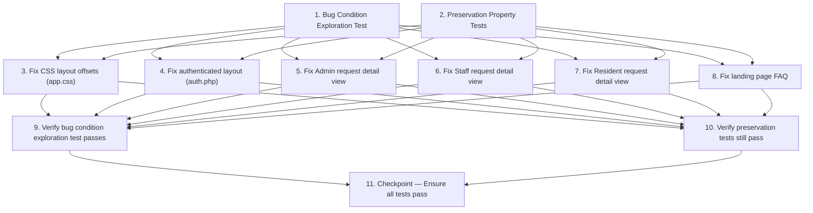

# Implementation Plan

## Overview

Six view-layer-only defects are fixed across five files. No database, controller, route, or
authentication changes are required. The workflow follows the exploratory bugfix methodology:
confirm the bugs exist first, lock down preserved behaviour, then apply each fix and verify.

---

## Task Dependency Graph



```json
{
  "waves": [
    { "wave": 1, "tasks": ["1", "2"] },
    { "wave": 2, "tasks": ["3", "4", "5", "6", "7", "8"] },
    { "wave": 3, "tasks": ["9", "10"] },
    { "wave": 4, "tasks": ["11"] }
  ]
}
```

## Tasks

- [x] 1. Write bug condition exploration test
  - **Property 1: Bug Condition** - Composite View Defects (Duplicate Header / Missing Track Request / Incomplete FAQ / Native Dialog / Generic Terminal Messages)
  - **CRITICAL**: This test MUST FAIL on unfixed code — failure confirms the bugs exist
  - **DO NOT attempt to fix the test or the code when it fails**
  - **NOTE**: This test encodes the expected behavior — it will validate the fixes when it passes after implementation
  - **GOAL**: Surface counterexamples that demonstrate each defect exists in the current codebase
  - **Scoped PBT Approach**: Scope each property to the concrete failing cases identified in `isBugCondition()` from `design.md`
  - Load `views/layouts/auth.php` and assert `.auth-header` element IS present (bug condition: layout = 'auth') — expect assertion to hold on unfixed code
  - Load `views/layouts/auth.php` for Resident role and assert sidebar does NOT contain a link to `/resident/track` — expect assertion to hold on unfixed code
  - Load `views/home/index.php` and count `accordion-item` elements — assert COUNT < 15 (currently 6) — expect assertion to hold on unfixed code
  - Load `views/admin/requests/show.php` with `$allowedNext = ['under_verification']` and assert `form[data-confirm]` IS present — expect assertion to hold on unfixed code
  - Load `views/admin/requests/show.php` with `$status = 'completed'` and `$allowedNext = []` and assert terminal message contains "terminal state" — expect assertion to hold on unfixed code
  - Load `views/admin/requests/show.php` with `$status = 'cancelled'` and `$allowedNext = []` and assert terminal message contains "terminal state" — expect assertion to hold on unfixed code
  - Load `views/staff/requests/show.php` with `$status = 'completed'` / `$status = 'cancelled'` and assert same generic message — expect assertion to hold on unfixed code
  - Load `views/resident/requests/show.php` with `$status = 'completed'` / `$status = 'cancelled'` and assert no completion/cancellation card is present in the right column — expect assertion to hold on unfixed code
  - Run test on UNFIXED code
  - **EXPECTED OUTCOME**: All assertions pass (this is correct — they prove each bug exists)
  - Document counterexamples found (e.g., `.auth-header` found in DOM, `/resident/track` absent from sidebar, 6 FAQ items, `data-confirm` on Begin Verification form, "terminal state" text for completed/cancelled)
  - Mark task complete when test is written, run, and each counterexample is documented
  - _Requirements: 1.1, 1.2, 1.3, 1.4, 1.5, 1.6, 1.9, 1.11, 1.12, 1.13, 1.14_

- [x] 2. Write preservation property tests (BEFORE implementing fix)
  - **Property 2: Preservation** - Non-Buggy Page Renders and Existing Interactive Behaviour
  - **IMPORTANT**: Follow observation-first methodology — observe behaviour on UNFIXED code before writing assertions
  - Observe: `views/layouts/auth.php` — sidebar `active` class and `aria-current` are applied correctly for each `$activePage` value across all three roles (resident, staff, admin)
  - Observe: `views/layouts/auth.php` — sidebar logout form carries a `_csrf_token` hidden input and POSTs to `/logout`
  - Observe: `views/layouts/auth.php` — Resident sidebar notification badge is rendered when `$unreadCount > 0`
  - Observe: `views/admin/requests/show.php` — Reject, Additional Info Required, Cancel modals still render when those statuses are in `$allowedNext`; each modal form carries `_csrf_token` and `new_status`
  - Observe: `views/staff/requests/show.php` — same modal behaviour for Reject, Additional Info Required, Cancel
  - Observe: `app.js` `data-loading` handler fires for forms carrying `data-loading` attribute — submit button becomes disabled with spinner
  - Observe: `public/assets/css/app.css` — `.sidebar` currently has `top: var(--header-height)` and `.auth-content` has `margin-top: var(--header-height)` (these are the values that must change without breaking layout)
  - Observe: all public landing page sections (hero, features, about, services, how-it-works, existing FAQ accordion structure, announcement bar, contact) are present in `views/home/index.php`
  - Write property-based tests: for any role × activePage combination, sidebar active link is exactly the page with matching `$activePage` — all others are inactive
  - Write property-based tests: for any `$allowedNext` set NOT containing `under_verification`, no `#modal-under_verification` is rendered — existing modal/form pattern is unchanged
  - Write property-based tests: for any `$status` that is NOT `completed` or `cancelled`, the Admin/Staff terminal message branch is NOT reached
  - Verify all tests PASS on UNFIXED code
  - _Requirements: 3.1, 3.2, 3.3, 3.4, 3.5, 3.6, 3.7, 3.8, 3.9, 3.10, 3.11, 3.12, 3.13, 3.14_

- [x] 3. Fix CSS layout offsets (app.css)

  - [x] 3.1 Update `.sidebar` top and height values
    - In `public/assets/css/app.css` Section 7 (Sidebar Navigation), change `top: var(--header-height)` to `top: 0`
    - Add `height: 100vh` to `.sidebar` rule (replacing the implicit `bottom: 0` stretch)
    - The `bottom: 0` declaration can be kept or replaced — `height: 100vh` is the authoritative value
    - _Bug_Condition: isBugCondition(X) where X.layout = 'auth' AND sidebar.top = var(--header-height)_
    - _Expected_Behavior: sidebar.top = '0', sidebar fills full viewport height_
    - _Preservation: Section 27 dark sidebar overrides, mobile transform rules, sidebar-open class behaviour — all unchanged_
    - _Requirements: 2.2_

  - [x] 3.2 Update `.auth-content` margin and min-height values
    - In Section 8 (Authenticated Main Content Area), change `margin-top: var(--header-height)` to `margin-top: 0`
    - Change `min-height: calc(100vh - var(--header-height))` to `min-height: 100vh`
    - Section 34 override `padding: 1.75rem 1.5rem !important` is unchanged
    - _Bug_Condition: isBugCondition(X) where X.layout = 'auth' AND auth-content.marginTop = 60px_
    - _Expected_Behavior: auth-content.marginTop = 0, content fills freed vertical space_
    - _Preservation: Existing padding, background colour, and all other `.auth-content` rules unchanged_
    - _Requirements: 2.2_

- [x] 4. Fix authenticated layout (views/layouts/auth.php)

  - [x] 4.1 Remove the entire `<header class="auth-header">` block
    - Delete the complete `<header class="auth-header" role="banner"> … </header>` element from `views/layouts/auth.php`
    - This removes: sidebar toggle button, brand link, notification bell (resident), and user dropdown
    - Keep the `<div class="sidebar-overlay" id="sidebarOverlay">` element — it is required for mobile overlay behaviour
    - Keep the `<nav class="sidebar" id="appSidebar">` element entirely unchanged at this step
    - _Bug_Condition: isBugCondition(X) where X.layout = 'auth' — header present_
    - _Expected_Behavior: No `.auth-header` element in DOM for any authenticated page_
    - _Preservation: sidebar-overlay div, sidebar nav, main content area — all unchanged by this step_
    - _Requirements: 2.1_

  - [x] 4.2 Add user identity strip inside the sidebar (after sidebar-brand block)
    - Immediately after the closing `</a>` of the `.sidebar-brand` block and before the `<ul class="sidebar-nav">`, insert the user identity strip:
    ```html
    <!-- User identity strip (replaces header user dropdown) -->
    <div class="sidebar-user px-3 py-2 border-bottom"
         style="border-color:rgba(255,255,255,0.12)!important;">
        <div class="d-flex align-items-center gap-2">
            <i class="bi bi-person-circle text-white" style="font-size:1.2rem;" aria-hidden="true"></i>
            <div>
                <div style="font-size:0.8125rem;font-weight:600;color:#fff;line-height:1.2;">
                    <?= $firstName ?> <?= $lastName ?>
                </div>
                <span class="role-badge role-badge-<?= strtolower($role) ?>" style="font-size:0.6rem;">
                    <?= htmlspecialchars(ucfirst($role), ENT_QUOTES, 'UTF-8') ?>
                </span>
            </div>
        </div>
    </div>
    ```
    - _Bug_Condition: isBugCondition(X) where header removed but user identity not yet visible in sidebar_
    - _Expected_Behavior: User first+last name and role badge visible in sidebar for all three portals_
    - _Preservation: sidebar-brand block, all nav items, logout form — unchanged_
    - _Requirements: 2.5_

  - [x] 4.3 Add mobile sidebar toggle button inside `<main class="auth-content">`
    - At the very top of the `<main class="auth-content" id="main-content" role="main">` block, before the flash message PHP block, insert:
    ```html
    <!-- Mobile sidebar toggle — only visible on small screens (replaces header toggle) -->
    <button class="btn-sidebar-toggle d-lg-none mb-3" id="sidebarToggle"
            aria-label="Toggle sidebar navigation"
            aria-controls="appSidebar" aria-expanded="false">
        <i class="bi bi-list" aria-hidden="true"></i> Menu
    </button>
    ```
    - The existing `app.js` handler targets `#sidebarToggle` — no JS change needed
    - `d-lg-none` ensures the button is hidden on desktop (≥ 992px) where the sidebar is always visible
    - _Bug_Condition: isBugCondition(X) where header removed and no accessible mobile toggle remains_
    - _Expected_Behavior: Mobile users can open/close sidebar via hamburger button in the main content area_
    - _Preservation: app.js sidebar toggle logic (getElementById sidebarToggle + classList.toggle sidebar-open) — unchanged_
    - _Requirements: 2.4_

  - [x] 4.4 Add "Track Request" navigation link to the Resident sidebar block
    - In the `<?php if ($role === 'resident'): ?>` section, after the existing "My Requests" `<li>` and before the "Notifications" `<li>`, insert:
    ```html
    <li class="nav-item">
        <a class="nav-link <?= $activePage === 'track' ? 'active' : '' ?>"
           href="<?= $appUrl ?>/resident/track"
           <?= $activePage === 'track' ? 'aria-current="page"' : '' ?>>
            <i class="bi bi-search" aria-hidden="true"></i> Track Request
        </a>
    </li>
    ```
    - Uses `$activePage === 'track'` to match the identifier that the Track Request controller sets
    - _Bug_Condition: isBugCondition(X) where X.layout = 'auth' AND X.role = 'resident' AND sidebarLinks NOT CONTAINS 'track-request'_
    - _Expected_Behavior: Resident sidebar under REQUESTS section contains "Track Request" link to /resident/track_
    - _Preservation: Existing "New Request", "My Requests", "Notifications" links — positions and href values unchanged_
    - _Requirements: 2.9_

- [x] 5. Fix Admin request detail view (views/admin/requests/show.php)

  - [x] 5.1 Replace "Begin Verification" data-confirm form with a Bootstrap modal trigger
    - In the `foreach ($allowedNext as $next)` loop, find the `$hasModal` assignment
    - Change the condition from:
      `$hasModal = isset($needsRemark[$next]) || $next === RequestModel::STATUS_CANCELLED;`
      to:
      `$hasModal = isset($needsRemark[$next]) || $next === RequestModel::STATUS_CANCELLED || $next === RequestModel::STATUS_UNDER_VERIFICATION;`
    - This routes `under_verification` down the modal button path instead of the `data-confirm` form path
    - The existing `data-confirm` handler in `app.js` is NOT modified — it simply will not be triggered for this action any more
    - _Bug_Condition: isBugCondition(X) where X.nextAction = 'under_verification' AND X.confirmMethod = 'window.confirm'_
    - _Expected_Behavior: Clicking "Begin Verification" opens Bootstrap modal #modal-under_verification; window.confirm is never called_
    - _Preservation: data-confirm handler in app.js untouched; Approve, Mark Ready for Claiming, Mark Completed direct-submit forms unchanged_
    - _Requirements: 2.15, 2.16_

  - [x] 5.2 Add the Begin Verification confirmation modal to the modal-generation loop
    - In the modal-generation `foreach` loop at the bottom of the file (currently only iterates statuses in `$needsRemark`), add a separate branch before or after the remark-modal loop:
    ```php
    <?php if (in_array(RequestModel::STATUS_UNDER_VERIFICATION, $allowedNext, true)): ?>
    <div class="modal fade" id="modal-under_verification" tabindex="-1"
         aria-labelledby="modal-under_verification-label" aria-modal="true"
         data-bs-backdrop="static">
        <div class="modal-dialog modal-dialog-centered">
            <div class="modal-content">
                <div class="modal-header">
                    <h3 class="modal-title h5" id="modal-under_verification-label">
                        Begin Verification
                    </h3>
                    <button type="button" class="btn-close" data-bs-dismiss="modal"
                            aria-label="Close"></button>
                </div>
                <div class="modal-body" style="font-size:0.9rem;">
                    Move this request to <strong>Under Verification</strong>?
                    The resident will be notified.
                </div>
                <div class="modal-footer">
                    <button type="button" class="btn btn-secondary"
                            data-bs-dismiss="modal">Cancel</button>
                    <form method="POST"
                          action="<?= $e($appUrl) ?>/admin/requests/<?= $requestId ?>/status"
                          data-loading="Updating…" class="d-inline">
                        <input type="hidden" name="_csrf_token" value="<?= $e($csrfToken) ?>">
                        <input type="hidden" name="new_status"
                               value="<?= $e(RequestModel::STATUS_UNDER_VERIFICATION) ?>">
                        <button type="submit" class="btn btn-primary">
                            Begin Verification
                        </button>
                    </form>
                </div>
            </div>
        </div>
    </div>
    <?php endif; ?>
    ```
    - Modal uses `data-bs-backdrop="static"` consistent with existing remark modals
    - Form carries `_csrf_token` and `new_status=under_verification`; `data-loading` preserves double-submit prevention
    - _Bug_Condition: isBugCondition(X) where Begin Verification button has no Bootstrap modal backing it_
    - _Expected_Behavior: #modal-under_verification is present when under_verification is in $allowedNext; Cancel closes modal without submission; confirm button submits POST with correct payload_
    - _Preservation: All existing remark modals (Reject, Additional Info, Cancel) and their form actions unchanged_
    - _Requirements: 2.12, 2.13, 2.14_

  - [x] 5.3 Replace generic terminal-state message with status-specific messages
    - In the Actions panel card body, replace the `if (empty($allowedNext)):` generic message:
      `<p class="text-muted mb-0">… No further actions — request is in a terminal state.</p>`
      with a three-branch conditional:
    ```php
    <?php if (empty($allowedNext)): ?>
        <?php if ($status === RequestModel::STATUS_COMPLETED): ?>
        <p class="mb-0" style="font-size:0.875rem;color:var(--emu-success);">
            <i class="bi bi-check-circle-fill me-1" aria-hidden="true"></i>
            <strong>Already Completed</strong><br>
            <span class="text-muted">No further actions required.</span>
        </p>
        <?php elseif ($status === RequestModel::STATUS_CANCELLED): ?>
        <p class="text-muted mb-0" style="font-size:0.875rem;">
            <i class="bi bi-slash-circle me-1" aria-hidden="true"></i>
            <strong style="color:var(--emu-text-primary);">Request Cancelled</strong><br>
            No further actions available.
        </p>
        <?php else: ?>
        <p class="text-muted mb-0" style="font-size:0.875rem;">
            <i class="bi bi-lock me-1" aria-hidden="true"></i>
            No further actions — request is in a terminal state.
        </p>
        <?php endif; ?>
    ```
    - The `else` branch preserves the original message for any other terminal status (e.g. `rejected`)
    - _Bug_Condition: isBugCondition(X) where X.requestStatus IN ['completed','cancelled'] AND X.terminalMessage = 'generic'_
    - _Expected_Behavior: completed → "Already Completed" with green check; cancelled → "Request Cancelled" with slash-circle_
    - _Preservation: rejected status and any other non-empty $allowedNext — unchanged_
    - _Requirements: 2.17, 2.18_

- [x] 6. Fix Staff request detail view (views/staff/requests/show.php)

  - [x] 6.1 Replace generic terminal-state message with status-specific messages
    - In the Staff Actions panel card body, apply the identical three-branch replacement as task 5.3
    - Replace:
      `No further actions are available. This request is in a terminal state.`
      with the same `completed` / `cancelled` / `else` conditional structure
    - Use `RequestModel::STATUS_COMPLETED` and `RequestModel::STATUS_CANCELLED` constants (already imported via `use` at top of file)
    - HTML and CSS values are identical to the Admin view fix
    - _Bug_Condition: isBugCondition(X) where X.layout = 'staff-request-detail' AND X.requestStatus IN ['completed','cancelled'] AND X.terminalMessage = 'generic'_
    - _Expected_Behavior: completed → "Already Completed"; cancelled → "Request Cancelled" — same messages as Admin view_
    - _Preservation: Reject, Additional Info, Cancel remark modals and their triggers — unchanged; data-loading on modal forms — unchanged_
    - _Requirements: 2.19, 2.20_

- [x] 7. Fix Resident request detail view (views/resident/requests/show.php)

  - [x] 7.1 Add "Request Completed" and "Request Cancelled" right-column status cards
    - In the right column (`<div class="col-12 col-lg-4">`), after the existing `ready_for_claiming` card block, add two new `elseif` branches:
    ```php
    <?php elseif (strtolower($status) === 'completed'): ?>
    <div class="card">
        <div class="card-body text-center py-4" style="font-size:0.875rem;">
            <i class="bi bi-check-circle-fill mb-2 d-block"
               style="font-size:2rem;color:var(--emu-success);" aria-hidden="true"></i>
            <p class="fw-600 mb-1" style="color:var(--emu-success);">Request Completed</p>
            <p class="text-muted mb-0">
                Your request has been fulfilled. No further action is required.
            </p>
        </div>
    </div>

    <?php elseif (strtolower($status) === 'cancelled'): ?>
    <div class="card">
        <div class="card-body text-center py-4" style="font-size:0.875rem;">
            <i class="bi bi-slash-circle mb-2 d-block"
               style="font-size:2rem;color:var(--emu-neutral);" aria-hidden="true"></i>
            <p class="fw-600 mb-1" style="color:var(--emu-text-primary);">Request Cancelled</p>
            <p class="text-muted mb-0">
                This request has been cancelled. No further action is required.
            </p>
        </div>
    </div>
    <?php endif; ?>
    ```
    - The existing `ready_for_claiming` block uses `<?php if (…): ?>` — change it to allow the new branches to chain: keep `if` for `ready_for_claiming` and add `elseif` for `completed` and `cancelled`
    - _Bug_Condition: isBugCondition(X) where X.layout = 'resident-request-detail' AND X.requestStatus IN ['completed','cancelled'] AND no status card in right column_
    - _Expected_Behavior: Resident sees an informational card in the right column for completed and cancelled requests_
    - _Preservation: ready_for_claiming Claiming Instructions card — identical; Cancel Request modal — unchanged; status history timeline — unchanged_
    - _Requirements: 2.21, 2.22_

- [x] 8. Fix landing page FAQ (views/home/index.php)

  - [x] 8.1 Replace 6-item FAQ array with 15-item FAQ array
    - In `views/home/index.php` within the `<!-- SECTION: FAQs -->` block, replace the entire `$faqs = [ … ]` array (currently 6 entries) with the 15-entry array from `design.md` Section "File 6 Change 6a"
    - The accordion structure (`foreach ($faqs as $i => $faq)`) and Bootstrap accordion markup remain unchanged
    - The first item (`$i === 0`) will continue to be expanded by default
    - Verify the array has exactly 15 entries covering: What is eMunicipal, Create account, Log in, Request a document, Select document type, See requirements, Upload documents, Track request, Find reference number, Cancel request, Status change notifications, In-app notifications, After approval, Claim document, Rejected/cancelled handling
    - _Bug_Condition: isBugCondition(X) where X.layout = 'public' AND X.page = 'home' AND COUNT(X.faqItems) < 15_
    - _Expected_Behavior: FAQ accordion renders 15 items; each item opens/closes with Bootstrap accordion animation; aria-expanded toggles correctly_
    - _Preservation: All other landing page sections (hero, features, about, services, how-it-works, announcement, contact) — unchanged; accordion component markup and Bootstrap CDN — unchanged_
    - _Requirements: 2.10, 2.11_

- [x] 9. Verify bug condition exploration test now passes
  - **Property 1: Expected Behavior** - Composite View Defects Resolved
  - **IMPORTANT**: Re-run the SAME test from task 1 — do NOT write a new test
  - The test from task 1 encodes the expected behavior; when it passes, it confirms the fixes are correct
  - Run bug condition exploration test from step 1 against the FIXED code
  - Verify: `.auth-header` element is ABSENT from all authenticated page renders
  - Verify: Resident sidebar contains `/resident/track` link under REQUESTS section
  - Verify: Landing page FAQ accordion contains exactly 15 `accordion-item` elements
  - Verify: `form[data-confirm]` is NOT present in `views/admin/requests/show.php` for `under_verification`; `#modal-under_verification` IS present
  - Verify: Admin `completed` request → Actions panel shows "Already Completed" (no "terminal state" text)
  - Verify: Admin `cancelled` request → Actions panel shows "Request Cancelled"
  - Verify: Staff `completed` / `cancelled` → same status-specific messages
  - Verify: Resident `completed` / `cancelled` → right-column card is present
  - **EXPECTED OUTCOME**: All assertions pass (confirms all bugs are fixed)
  - _Requirements: 2.1, 2.2, 2.4, 2.5, 2.9, 2.10, 2.11, 2.12, 2.13, 2.14, 2.15, 2.16, 2.17, 2.18, 2.19, 2.20, 2.21, 2.22_

- [x] 10. Verify preservation tests still pass
  - **Property 2: Preservation** - Non-Buggy Renders Unchanged
  - **IMPORTANT**: Re-run the SAME tests from task 2 — do NOT write new tests
  - Run preservation property tests from step 2 against the FIXED code
  - Verify sidebar active-link state is correct for all `$activePage` × role combinations
  - Verify logout form still has `_csrf_token` hidden input and POSTs to `/logout`
  - Verify Resident notification badge still renders in sidebar when `$unreadCount > 0`
  - Verify Reject, Additional Info Required, Cancel modals in Admin and Staff views are unchanged
  - Verify `data-loading` double-submit prevention fires for all forms carrying the attribute
  - Verify all public landing page sections are present and structurally unchanged
  - Verify login/register pages (minimal-split layout, not auth.php) are visually unaffected
  - **EXPECTED OUTCOME**: All preservation tests PASS (confirms no regressions)
  - _Requirements: 3.1, 3.2, 3.3, 3.4, 3.5, 3.6, 3.7, 3.8, 3.9, 3.10, 3.11, 3.12, 3.13, 3.14_

- [x] 11. Checkpoint — Ensure all tests pass
  - Confirm Property 1 (Bug Condition) test passes — all six defects resolved
  - Confirm Property 2 (Preservation) tests pass — no regressions introduced
  - Manually load a page from each portal (Resident dashboard, Staff requests, Admin requests) and confirm the sidebar starts at the top of the viewport with no gap above it
  - Manually resize to ≤ 991px and confirm the mobile hamburger button appears in the main content area and toggles the sidebar correctly
  - Manually open the landing page and confirm 15 FAQ items are visible and accordion animation works
  - Manually open a pending request as Admin and confirm "Begin Verification" opens a Bootstrap modal (not a browser dialog)
  - Manually open completed and cancelled requests as Admin, Staff, and Resident and confirm status-specific messages appear
  - Ask the user if any questions arise before marking this task complete

## Notes

- All fixes are **view-layer only** — no controller, route, model, or database changes are required.
- Tasks 1 and 2 (exploration and preservation tests) are independent of each other and should both be completed before any implementation task begins.
- Implementation tasks 3–8 are largely independent of each other and can be worked in any order after the tests in tasks 1–2 are written and baselined.
- The exploration test (task 1) is expected to **fail** on unfixed code — this is intentional and confirms each bug exists. Do not fix the code to make it pass prematurely.
- The preservation test (task 2) is expected to **pass** on unfixed code — this establishes the behavioural baseline before any changes are made.
- Task 4 (auth.php) has internal ordering constraints: remove the header (4.1) before adding the sidebar user strip (4.2) and mobile toggle (4.3), as the user strip and toggle compensate for content that was in the removed header.
- The `RequestModel::STATUS_UNDER_VERIFICATION`, `STATUS_COMPLETED`, and `STATUS_CANCELLED` constants used in tasks 5 and 6 are already imported via `use` at the top of the respective view files.
- The 15-item FAQ array content is defined in `design.md` Section "File 6 Change 6a" — refer to it when completing task 8.1.
- No JavaScript changes are needed; the existing `app.js` sidebar toggle and `data-loading` handlers work with the restructured markup without modification.
